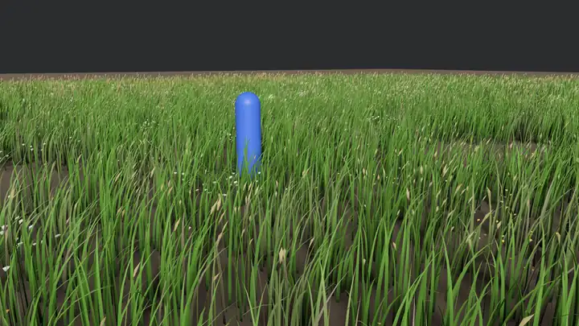
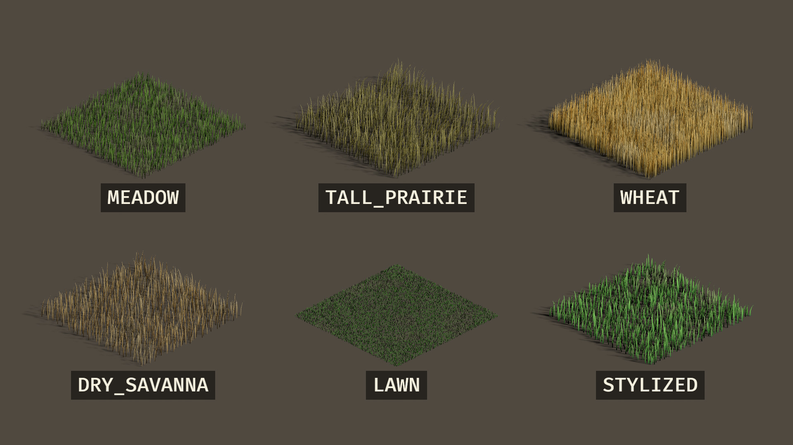
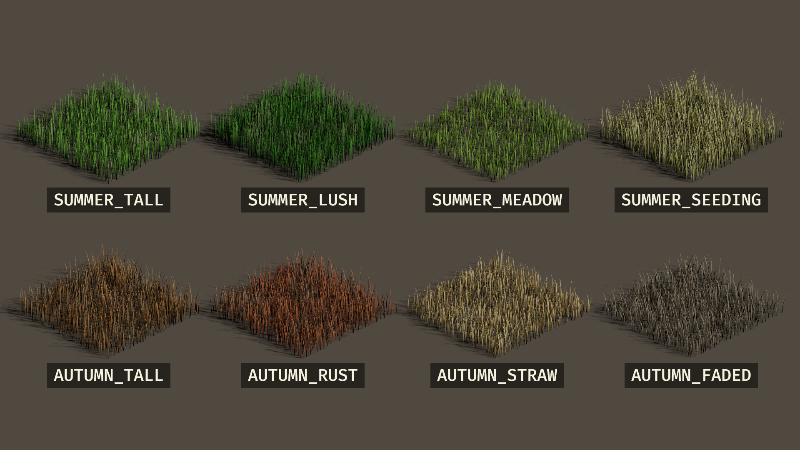
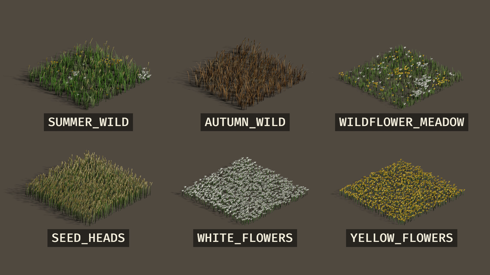
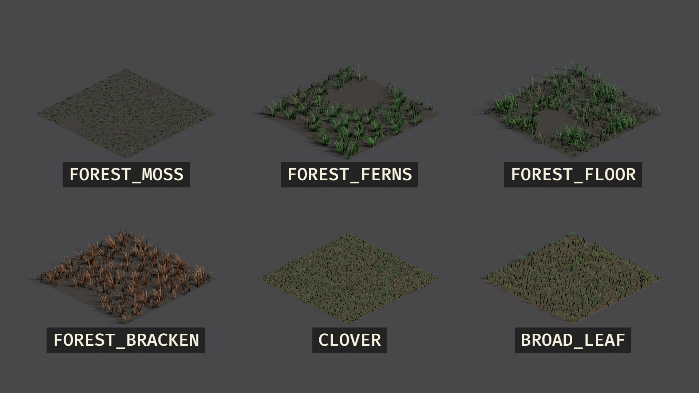
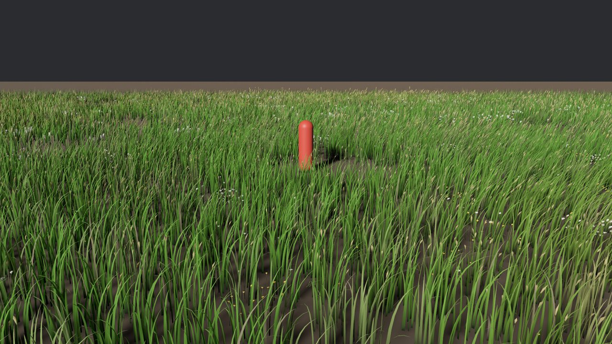
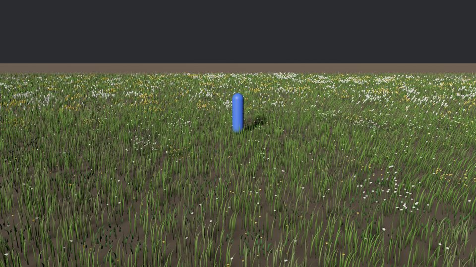
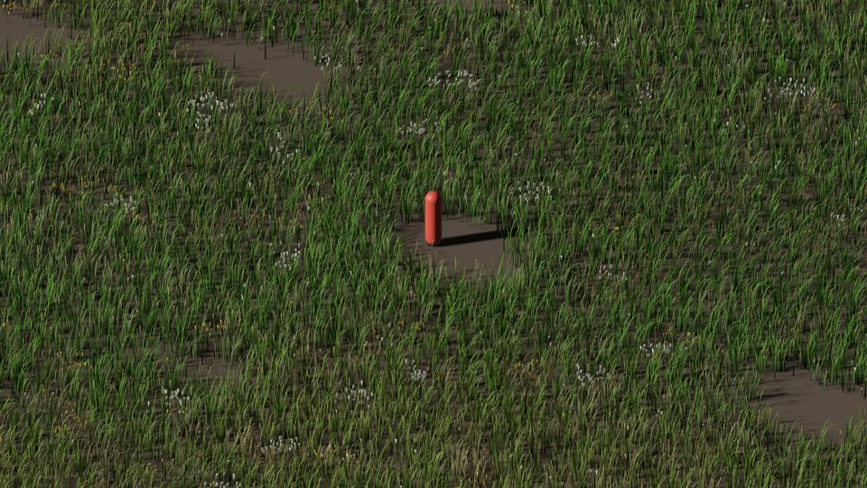

# bevy_grass

GPU-driven, wind-animated grass for [Bevy](https://bevy.org) 0.20: fields of
any size, tall walkable grass, flowers and seed heads, trampling, and every
blade lit by Bevy's own PBR.



All 26 presets, two rows per picture, each a square of about 6 m under a
top-down ARPG camera and labelled in large type. Run
`cargo run --release --example showcase` for page 1; `--page 2` to `--page 4`
draw the rest (`--fixed-time --screenshot PATH` saves one).









|  |  |  |
| --- | --- | --- |

- **No blades are stored.** Every frame, compute shaders decide which blades
  exist near each camera and build them on the GPU. A 4 km field costs what a
  200 m field does, and the CPU does nothing per frame.
- **Looks like grass up close and from afar.** Curved, tapered blades with
  rounded normals, three layers of wind, light through backlit blades, clump
  colour, sheen, and a ground material that carries the grass colour past the
  last blade.
- **Varies the way real fields do.** Mix in other plants (seed heads, flowers,
  clover, broad leaves, ferns) in any proportion. Gather blades into tufts,
  leave bare patches, and let blades twist, droop and fold. Add colour patches,
  dry tips and dead blades. Every kind is optional and costs nothing when off.
- **Part of Bevy's renderer.** Grass casts and receives shadows and is fogged.
  It draws into the depth, normal and motion-vector prepass (SSAO and TAA see
  it, with exact motion vectors) and into the deferred G-buffer.
- **26 presets**, from lawn to prairie to wildflower meadow to forest-floor
  moss, ferns and bracken, also shipped as `.grass.ron` files that reload
  while the game runs.

> **Status:** pre-release (0.2). Everything on this page is built and
> tested. Runtime editing (paint, cut, regrow), mesh terrain and a crates.io
> release are next; see [Roadmap](#roadmap).

## Contents

- [Installation](#installation)
- [Quick start](#quick-start)
- [Usage](#usage)
- [Examples](#examples)
- [API](#api)
- [How it is fast](#how-it-is-fast)
- [How it looks good](#how-it-looks-good)
- [Performance](#performance)
- [Roadmap](#roadmap)
- [License](#license)

## Installation

Add the crate next to Bevy in your game's `Cargo.toml`:

```toml
[dependencies]
bevy = "0.20"
bevy_grass = { git = "https://github.com/GEMI/bevy-grass" }
```

| Bevy | bevy_grass |
| --- | --- |
| 0.20 | 0.2 |

Requirements:

- **Bevy 0.20.** bevy_grass accepts any Bevy 0.20.x (it is tested on 0.20.0) and enables only `bevy_asset`,
  `bevy_log`, `bevy_render`, `bevy_core_pipeline` and `bevy_pbr`, all of which
  `DefaultPlugins` games already have. Adding it never changes how Bevy is
  compiled for your game.
- **Rust 1.97.1 or newer.**
- **A GPU with compute shaders.** Blades are generated by compute shaders and
  read from storage buffers in the vertex shader, so WebGL2 is not supported.
  Developed and tested on Windows with Vulkan and DX12, and on Linux (X11) with
  Vulkan on an NVIDIA GPU. Other native platforms should work wherever Bevy runs
  compute shaders, but have not been tested yet.

## Quick start

Add `GrassPlugins` after `DefaultPlugins`, and spawn a `GrassField`. This whole
program is [`examples/minimal.rs`](examples/minimal.rs); `cargo run --release
--example minimal` runs it:

```rust
use bevy::prelude::*;
use bevy_grass::prelude::*;

fn main() {
    App::new()
        .add_plugins((DefaultPlugins, GrassPlugins))
        .add_systems(Startup, setup)
        .run();
}

fn setup(
    mut commands: Commands,
    mut meshes: ResMut<Assets<Mesh>>,
    mut materials: ResMut<Assets<StandardMaterial>>,
    mut styles: ResMut<Assets<GrassStyle>>,
) {
    commands.spawn((
        Camera3d::default(),
        Transform::from_xyz(0.0, 1.5, 6.0).looking_at(Vec3::new(0.0, 0.4, 0.0), Vec3::Y),
    ));
    commands.spawn((
        DirectionalLight {
            shadow_maps_enabled: true,
            ..default()
        },
        Transform::from_xyz(4.0, 8.0, 3.0).looking_at(Vec3::ZERO, Vec3::Y),
    ));
    commands.spawn((
        Mesh3d(meshes.add(Plane3d::default().mesh().size(64.0, 64.0))),
        MeshMaterial3d(materials.add(Color::srgb(0.2, 0.15, 0.09))),
    ));
    commands.spawn(GrassField::new(
        Vec2::splat(64.0),
        GrassStyle::MEADOW,
        &mut styles,
    ));
}
```

A field is a rectangle centred on its `Transform`, lying in the XZ plane. A
scene needs a camera, a light and something to stand on, as here.
`GrassField::new` adds the preset to `Assets<GrassStyle>` and returns the field
in one call. If a field is built with `..default()` and no style, it waits for
a style that will never load: after a few frames it logs a warning naming the
entity and how to give it one (`styles.add(GrassStyle::MEADOW)` or a loaded
`.grass.ron`).

`GrassPlugins` is a plugin group: `GrassPlugin` (the grass itself),
`FarGrassPlugin` (the terrain material for ground past the last blade) and
`GrassStyleFilePlugin` (`.grass.ron` files, and the presets as assets). Leave
out what you do not use:

```rust
app.add_plugins(GrassPlugins.build().disable::<FarGrassPlugin>());
```

## Usage

### Pick a quality tier

`GrassSettings` sets how far grass reaches, how dense it is, which blades cast
shadows, and how many blades and interactors each camera's buffers hold. It
has a preset per hardware tier, and you change what you like with struct
update syntax, the same as for styles and wind:

```rust
app.add_plugins(GrassPlugins.set(GrassPlugin {
    settings: GrassSettings {
        shadows: GrassShadows::Off,
        max_interactors: 512,
        ..GrassSettings::MEDIUM
    },
    ..default()
}));
```

Every setting can change at runtime, so a graphics menu can offer them. The
settings are also a resource:

```rust
fn apply_graphics_menu(mut grass: ResMut<GrassSettings>) {
    *grass = GrassSettings::LOW;
    grass.radius = 60.0; // Low, but reaching a little further
}
```

Raising `instance_capacity`, `max_interactors` or `max_chunk_slices` makes each
camera allocate its buffers again, once. Values out of range are clamped, with
a warning that names the setting.

### Tune the distances, the blades, the wind and the trampling

Nothing about how far grass reaches, how it thins, how it moves or how it is
trampled is fixed in the code. The tier presets set the first seven settings
below; every other setting is the same in all of them, and **its default is
the number the crate was designed and measured with**, so you only set one
when your game is not that game. A small-grass game seen from a few metres, a
strategy map seen from a kilometre, and a stylized low-poly meadow want
different numbers:

```rust
app.insert_resource(GrassSettings {
    // A third-person camera that rarely looks far: full detail twice as far,
    // and no fade-out until nearly the edge.
    lod1_start: 0.4,
    lod2_start: 0.7,
    fade_start: 0.95,
    // Low-poly blades: 3, 2 and 1 rows (7, 5 and 3 vertices).
    blade_rows: [3, 2, 1],
    // Deep snow: trails take 6 s to fill in, and a vehicle flattens 5 m.
    trample_recovery: 6.0,
    max_interactor_radius: 5.0,
    ..GrassSettings::HIGH
});

app.insert_resource(GrassWind {
    sway: 0.5,          // calmer individual blades
    gust_contrast: 2.0, // but deeper waves across the field
    ..GrassWind::BREEZE
});
```

**`GrassSettings`**, the first seven set by the tier:

| Setting | Default | Meaning |
| --- | --- | --- |
| `radius` | 100 m | How far grass reaches from a perspective camera (1 and up). Orthographic cameras ignore it |
| `density_scale` | 1 | Multiplies every style's density (0 and up) |
| `min_width_px` | 1 | Narrowest a blade is drawn, in pixels |
| `shadows` | `Near` | `Off`, `Near` or `Full` |
| `orthographic_lod` | 1 | The level of detail orthographic cameras draw at, 0 to 2 |
| `instance_capacity` | 600,000 | Visible blades each camera's buffers hold (32 bytes each), up to 4,000,000 |
| `max_interactors` | 64 | Interactors a camera stamps a frame, up to 65,536 |
| `blade_rows` | `[7, 3, 1]` | Rows in a blade of LOD 0, 1 and 2, 1 to 31 each. A row is two vertices, plus one for the tip |
| `lod1_start`, `lod2_start` | 0.2, 0.5 | Where LOD 1 and LOD 2 begin, as shares of `radius` (0 to 1, in order) |
| `fade_start` | 0.9 | Where the last fade to nothing begins, as a share of `radius`; 1 ends abruptly |
| `lod_blend` | 4 m | Width of the dithered band around each LOD boundary |
| `lod2_density`, `fade_density` | 0.5, 0.15 | Share of blades kept where LOD 2 begins and where the fade begins (density falls in a line from 1 at `lod1_start`) |
| `mid_range_density` | 0.5 | A further share kept from LOD 1 on; the survivors widen to cover. Raise it for lusher mid-distance at a price |
| `max_widening` | 2.5 | The most thinned blades widen, as a multiple of their width (1 to 3.2) |
| `turn_to_camera` | 0.4 | How far an edge-on blade turns toward the camera: 0 thins to lines, 1 always faces it |
| `orthographic_extent` | 256 m | Half the side of the square around an orthographic camera in which blades are stored (8 to 4,096). Blades further away are misplaced, so a map camera that sees a kilometre raises it; positions take 16 bits, so a bigger extent is coarser (8 mm at 256 m, 12 cm at 4,096 m) |
| `max_chunk_slices` | 8,192 | Slices of visible chunks a camera generates a frame (1 to 65,535; 16 bytes each). A very dense style or a long radius needs more; `GrassStats::gpu.slices` shows what is used |
| `readback_interval` | 120 | Frames between the GPU counter readbacks behind `GrassStats` and the overflow warnings; 0 never reads them |
| `trample_recovery` | 1.5 s | Time a fully flattened blade takes to spring back (0.01 and up) |
| `trample_cell_size` | 0.25 m | Cell of the trample window, 0.05 to 2. The window is 256 cells across: 64 m by default, 512 m at 2 |
| `max_interactor_radius` | 2 m | Largest interactor radius stamped, 0.1 to 16; the cost grows with its square |

**`GrassWind`**: `direction`, `strength`, `gust_scale` and `gust_speed`, as
before, and four multipliers that are 1 in every preset: `sway` (how far each
blade sways on its own), `sway_speed` (how fast), `flutter` (the shiver of the
tips of near blades) and `gust_contrast` (how much stronger the gusts are than
the wind between them; 0 is a steady wind).

### Bring your own wind

`GrassWind` drives the built-in model: gusts from a scrolling noise texture,
per-blade sway and tip flutter. That model is a plugin of its own, and the
grass actually reads one `GrassWindFrame` a frame. Turn the built-in model off
and any wind source can write that frame:

```rust
app.add_plugins(GrassPlugins.set(GrassPlugin {
    wind: false,
    ..default()
}));
// ...and in `Update`, in `GrassWindSystems::Sample`:
fn drive_wind(weather: Res<Weather>, mut wind: ResMut<GrassWindFrame>) {
    *wind = GrassWindFrame {
        direction: weather.direction,
        strength: weather.strength,
        ..GrassWind::BREEZE.into()
    };
}
```

`GrassWindFrame` has the shader's values directly: direction, strength, gust
size and scroll (`gust_offset` and `previous_gust_offset`, for motion
vectors), sway, flutter and gust contrast. Put the system in
`GrassWindSystems::Sample` so the blades and the far-grass material read the
same frame. The built-in model remains available by itself as
`GrassWindPlugin`; [`examples/custom_wind.rs`](examples/custom_wind.rs) is a
complete scene driven this way.

### Draw differently on one camera

Settings that are about a view live on the camera, as Bevy's own `Msaa` and
`Bloom` do. `GrassCamera` overrides any of `radius`, `density_scale`,
`min_width_px` and `shadows` for that camera; what it leaves at `None` follows
`GrassSettings`, including when that changes:

```rust
// A minimap at low detail beside a main camera at the settings' High.
commands.spawn((
    Camera3d::default(),
    GrassCamera {
        radius: Some(30.0),
        density_scale: Some(0.4),
        shadows: Some(GrassShadows::Off),
        ..default()
    },
));
```

A camera far above the ground, like an ARPG's, wants thicker blades: its
blades are thin on screen, so it asks for `min_width_px: Some(2.0)`. That is a
property of the camera, not of the grass, which is why it is not in
`GrassStyle`. (Old `.grass.ron` files that still set `min_width_px` load, with
a warning; the line is ignored.)

### Make your own style

`GrassStyle` is an asset, so many fields can share one. Start from a preset
and change what you need. A style is a `GrassBlade` (what the grass looks
like) plus what belongs to the whole field (density, variation, the ground,
toon shading, other plants), so the blade is one level in:

```rust
fn setup(mut commands: Commands, mut styles: ResMut<Assets<GrassStyle>>) {
    let style = GrassStyle {
        blade: GrassBlade {
            height: Vec2::new(0.6, 1.2),
            tip_color: Color::srgb(0.75, 0.70, 0.35),
            stiffness: 0.6,
            ..GrassStyle::TALL_PRAIRIE.blade
        },
        ..GrassStyle::TALL_PRAIRIE
    }
    .with_spacing(0.15); // blades about 15 cm apart

    commands.spawn((
        GrassField {
            size: Vec2::new(120.0, 80.0),
            style: styles.add(style),
            ..default()
        },
        Transform::from_xyz(40.0, 2.0, -10.0),
    ));
}
```

Changing a style asset at runtime (`styles.get_mut(&field.style)`) changes
every field that uses it on the next frame, and it is cheap enough to do every
frame, for a season or day/night blend or wet grass:

```rust
fn season(time: Res<Time>, mut styles: ResMut<Assets<GrassStyle>>, field: Single<&GrassField>) {
    let t = (time.elapsed_secs() * 0.1).sin() * 0.5 + 0.5;
    if let Some(mut style) = styles.get_mut(&field.style) {
        style.blade.tip_color = Color::srgb(0.34 + 0.3 * t, 0.56 - 0.1 * t, 0.14);
    }
}
```

What a change costs is in proportion to what it touches. A mask or heightmap
is read from its image once, and again only when that image changes (a 4096 by
4096 mask takes milliseconds to read, once, not per frame). A style change
rewrites only the entries of the fields that use that style, and the chunks,
masks and heightmaps are neither rebuilt nor uploaded again. Moving a field
sideways rewrites only its entry. A change no field shows costs nothing.
`GrassStats::tables` counts it: `images_read`, `entries_rewritten`, `rebuilds`
and the expensive `layout_rebuilds`.

### Change one field without a style of its own

"This meadow, a bit drier" for one area does not need another asset.
`GrassFieldOverrides` on a field tints its blades, scales their height and
thins or thickens them, while the style stays shared:

```rust
commands.spawn((
    GrassField { size: Vec2::splat(32.0), style: meadow.clone(), ..default() },
    GrassFieldOverrides {
        tint: Some(Color::srgb(1.3, 1.1, 0.7)), // multiplies root and tip colours
        height_scale: 0.6,
        density_scale: 0.5,
    },
));
```

The overrides are applied when the field's entries are built, so they cost
nothing per frame, and changing one rewrites that field's entries only.

### Grow grass on a heightmap, with a density mask

```rust
fn setup(
    mut commands: Commands,
    assets: Res<AssetServer>,
    mut styles: ResMut<Assets<GrassStyle>>,
) {
    // Masks and heightmaps are data, not colour: load them as linear.
    let linear = |path: &'static str| {
        assets
            .load_builder()
            .with_settings(|settings: &mut ImageLoaderSettings| settings.is_srgb = false)
            .load(path)
    };
    commands.spawn(GrassField {
        size: Vec2::splat(512.0),
        style: styles.add(GrassStyle::SUMMER_TALL),
        ground: GrassGround::Heightmap {
            image: linear("terrain/height.png"),
            height_scale: 40.0,
        },
        density_map: Some(linear("terrain/grass_mask.png")),
    });
}
```

Both images cover the whole field, and their first row is the field's −Z edge.
In the heightmap, red 0–1 spans `height_scale` metres above the field's
height. In the mask, red is density (0 bare, 1 full) and green multiplies the
blade height. The images are read on the CPU when the field changes, so keep
their CPU copy (Bevy's default for loaded images).
`ImageLoaderSettings` is `bevy::image::ImageLoaderSettings`.

### Let things trample the grass

```rust
commands.spawn((
    Transform::from_xyz(0.0, 0.0, 0.0),
    GrassInteractor { radius: 0.5, strength: 1.0, ..default() },
));
```

Grass within `radius` lies down away from the entity. When it leaves, the
grass springs back over about 1.5 s, so moving things leave trails. The cost
is the same for one interactor or 512.

The limits, which are also in the type's documentation. The numbers are the
defaults of `GrassSettings`, and each can be changed:

- **Radius, 2 m** (`max_interactor_radius`). A bigger radius is cut to it, with
  one warning naming the entity. Use a `GrassInteractorSpread` (or several
  interactors) for something bigger, or raise the setting (to 16 m at most):
  the cost grows with the square of the radius.
- **Count** (`max_interactors`). A camera stamps that many, the ones nearest
  to it first.
- **Distance, 64 m** (`trample_cell_size`, 256 cells across). Each camera
  tracks a 64 × 64 m square of ground around what it looks at; interactors
  outside it do nothing. Cells of 0.5 m make the window 128 m.
- **Recovery, 1.5 s** (`trample_recovery`). How long flattened grass takes to
  stand again.
- **Height.** Interaction is horizontal, so a bird flying over the meadow
  flattens it like a person walking in it. Give the bird
  `max_height: Some(1.0)`: it flattens grass only within a metre of the
  ground, fading out over the upper half. (The ground is the highest ground in
  the 16 m chunk of the field below it, so on a steep heightmap a flier is
  judged against the top of the slope.)

### Physics engines

Both Avian and Rapier already write `Transform`/`GlobalTransform`, and grass
reads `GlobalTransform`, so a hand-written `GrassInteractor` on a physics body
works without a bridge. The optional `rapier` feature goes one step further
and derives the footprint from the collider:

```toml
bevy_grass = { version = "0.2", features = ["rapier"] }
```

```rust
commands.spawn((
    RigidBody::Dynamic,
    Collider::capsule_y(0.5, 0.4),
    GrassInteractorFromCollider::default(),
));
```

The adapter reads Rapier's local AABB, so a capsule gets one disc, while a
vehicle, a wall or a big creature gets a `GrassInteractorSpread` of several
discs, each no bigger than `max_interactor_radius`. A disabled collider, a
disabled rigid body or a sensor flattens nothing. For a flying creature, set
`max_height: Some(height)`.

The `rapier` feature brings in `bevy_rapier3d` with `default-features = false`,
so it does not turn on `bevy_gizmos`, `bevy_picking` or other Bevy features.
It is 3D only; grass is 3D.

A large object does not need a physics engine for a spread either:

```rust
let (radius, spread) = GrassInteractorSpread::covering_aabb(
    Vec3::ZERO,
    Vec3::new(4.0, 0.5, 0.5), // half extents in local space
    2.0,                     // GrassSettings::max_interactor_radius
);
commands.spawn((GrassInteractor { radius, ..default() }, spread));
```

Avian support is waiting for an `avian3d` release built on Bevy 0.20;
`avian3d` 0.7 and its current `main` branch depend on Bevy 0.19.

### Change the wind, or turn grass shadows off at runtime

```rust
fn storm(mut wind: ResMut<GrassWind>) {
    *wind = GrassWind { direction: Vec2::new(1.0, 0.3), ..GrassWind::STORM };
}

fn toggle_shadows(keys: Res<ButtonInput<KeyCode>>, mut grass: ResMut<GrassSettings>) {
    if keys.just_pressed(KeyCode::KeyG) {
        grass.shadows = match grass.shadows {
            GrassShadows::Off => GrassShadows::Near,
            _ => GrassShadows::Off,
        };
    }
}
```

### See what grass is doing

"Why is there no grass here?" and "why did that frame spike?" can be answered
without a profiler.

**`GrassStats`** is a resource with the numbers: blades per level of detail,
visible chunk slices, buffer overflows, table rebuilds and how long the last
one took, and fields or species a limit left out. The GPU numbers are read
back every 120 frames (`GrassSettings::readback_interval`; 0 turns the
readback off), summed over cameras.

```rust
fn hud(stats: Res<GrassStats>) {
    if stats.gpu.overflows > 0 {
        warn!("grass buffers overflowed: raise GrassSettings::instance_capacity");
    }
    if stats.tables.fields_dropped > 0 {
        warn!("{} fields are not drawn: the tables hold 256 entries", stats.tables.fields_dropped);
    }
}
```

The same numbers are Bevy diagnostics, for `LogDiagnosticsPlugin` or an
overlay: `grass/blades/near`, `/mid`, `/far`, `grass/visible_slices`,
`grass/overflows`, `grass/table_rebuilds` and `grass/rebuild_time` (ms), as
the constants of `GrassDiagnostics`.

**`GrassDebugPlugin`** draws gizmos for what grass has: every field's
rectangle (grey while hidden, so scale, rotation and visibility problems show),
the 16 m chunks, each interactor's disc (red where a radius over the 2 m limit is cut
off) and each camera's trample window (64 m by default). Both follow the
settings. Toggle parts with the `GrassDebug`
resource; `enabled` is the master switch (the `meadow` example binds it to F3).
It needs the `debug` cargo feature, which turns on Bevy's `bevy_gizmos`, so
adding this crate never changes how Bevy is compiled:

```toml
bevy_grass = { version = "0.2", features = ["debug"] }
```

### Scenes, inspectors and save files

Every public type is reflected, with the type data tools look for:
`ReflectComponent` on `GrassField`, `GrassInteractor`, `GrassCamera` and
`NoGrass`; `ReflectResource` on `GrassWind` and `GrassSettings`; `ReflectAsset` on
`GrassStyle` (the plugin calls `register_asset_reflect`). So fields can be
spawned from `.scn.ron` scenes, BSN or Blender exporters such as Skein and
Blenvy, `GrassWind`, `GrassSettings` and styles show up in resource and asset
panels of inspectors such as `bevy-inspector-egui`, and a designer can tune a
meadow live there instead of editing RON. A reflected `GrassField` takes its
style from a handle, so give it one in code after loading the scene.

### Order your systems against the grass

Fields, styles and images are turned into GPU tables only when they change.
Two public system sets in `PostUpdate`, `GrassSystems::DetectChanges` then
`GrassSystems::Rebuild`, run after Bevy has propagated transforms and
visibility and sent asset events. Order your own systems against them when a
change must show this frame, for procedural terrain or runtime painting:

```rust
// Moving or showing fields: before DetectChanges.
app.add_systems(PostUpdate, stream_in_the_level.before(GrassSystems::DetectChanges));
// Editing a density mask, a heightmap or a style: before Bevy sends the
// asset events.
app.add_systems(PostUpdate, paint_density_mask.before(AssetEventSystems));
```

Systems in `Update` need no ordering. Without any, a change shows the next
frame.

### Shadows

Grass receives shadows from every light. It casts them for one directional
light, set by `GrassSettings::shadows` (`Off`, `Near`, `Full`), and a blade is
only a centimetre or two wide, so how that light's cascades are set up decides
whether blade shadows look right. Use a shallow first cascade, and mark the
light grass should follow with `GrassSun`:

```rust
commands.spawn((
    DirectionalLight { shadow_maps_enabled: true, ..default() },
    CascadeShadowConfigBuilder {
        num_cascades: 3,
        first_cascade_far_bound: 12.0,
        maximum_distance: 60.0,
        ..default()
    }
    .build(),
    GrassSun,
));
```

- **Why 12 m.** Grass draws its shadows into the first cascade (`Near`) or the
  first two (`Full`). A shadow texel is about `1.5 × first cascade depth ÷
  shadow map size`: with one cascade over 60 m in a 2048 map that is 4 to
  5 cm, wider than a blade, so each blade's shadow switches on and off as it
  sways across a texel centre and blade shadows blink. At 12 m a texel is
  under 1 cm.
- **Which light.** With a sun and a moon there are two directional lights.
  Without `GrassSun`, grass follows the first one that casts shadows (the one
  spawned first); with it, the marked one, and a marked light that casts no
  shadows means grass casts none.
- **The log helps.** The plugin warns, once, when the first cascade is deeper
  than the narrowest blades allow (it says how deep it can be), when several
  lights cast shadows and none is marked, when a marked light does not cast
  shadows, and when more than one light is marked.

### Mix in flowers, seed heads and clover

Any style can carry other plants, each with its share of the blades and how
much it grows in patches:

```rust
let field = GrassStyle::SUMMER_TALL.with_species(vec![
    GrassSpecies::new(GrassBlade::SEED_HEADS, 0.10),
    GrassSpecies::new(GrassBlade::WHITE_FLOWERS, 0.03).clustered(0.8),
    GrassSpecies::new(
        GrassBlade { head_color: Color::srgb(0.70, 0.45, 0.95), ..GrassBlade::WHITE_FLOWERS },
        0.02,
    )
    .clustered(0.8),
]);
let wild = GrassStyle {
    blade: GrassBlade {
        droop: 0.25, // tall blades arch over
        ..field.blade
    },
    variation: GrassVariation {
        tufts: 0.3,         // gather blades into tufts
        bare_share: 0.05, // 5% of the ground bare
        patch_amount: 0.4,  // colour drifts in patches several metres across
        dry_tips: 0.2,
        ..field.variation
    },
    ..field
};
```

A species is a `GrassBlade` and a share. The density, the ground and the
variation belong to the field's style, so a species has no place to put them:
the compiler does not let you set them there, and a `.grass.ron` file that
tries gets an error that names them.

`GrassStyle::SUMMER_WILD`, `AUTUMN_WILD` and `WILDFLOWER_MEADOW` are ready-made
examples. `GrassSpecies` and `GrassStyle` are not `Copy`, so to reuse a style
held in a variable after `..style`, write `..style.clone()` (`GrassBlade` is
`Copy`).

### Build a mixed preset

A mix is not made by adding two whole presets together. `FOREST_FLOOR`, for
example, starts from `FOREST_MOSS` and then mixes in fern, leaf-litter, clover
and broad-leaf blades as species (see [`src/presets/forest.rs`](src/presets/forest.rs)).
Each species has its own `GrassBlade`, so its shape, height and colours can
differ from the field's grass and from every other species:

```rust
let mixed = GrassStyle {
    blade: GrassBlade::MOSS,
    density: 140.0,
    species: vec![
        GrassSpecies { share: 0.20, clustering: 0.5, blade: GrassBlade::FERN },
        GrassSpecies {
            share: 0.10,
            clustering: 0.4,
            blade: GrassBlade {
                height: Vec2::new(0.12, 0.30),
                width: 0.07,
                tip_color: Color::srgb(0.45, 0.22, 0.08),
                ..GrassBlade::BROAD_LEAF
            },
        },
        GrassSpecies {
            share: 0.04,
            clustering: 0.8,
            blade: GrassBlade {
                head_color: Color::srgb(0.80, 0.30, 0.55),
                ..GrassBlade::WHITE_FLOWERS
            },
        },
    ]
    .into(),
    ..GrassStyle::FOREST_MOSS
};
```

The same mix as a `.grass.ron` file, with no Rust code at all:

```ron
(
    base: "FOREST_MOSS",
    density: 140.0,
    species: [
        (share: 0.20, clustering: 0.5, style: (base: "FOREST_FERNS")),
        (share: 0.10, clustering: 0.4, style: (
            base: "BROAD_LEAF",
            height: (0.12, 0.30),
            width: 0.07,
            tip_color: (0.45, 0.22, 0.08),
        )),
        (share: 0.04, clustering: 0.8, style: (
            base: "WHITE_FLOWERS",
            head_color: (0.80, 0.30, 0.55),
        )),
    ],
)
```

Load the file with `assets.load("grass/my_forest.grass.ron")`. To make it a
named preset in this crate instead, add one entry to the `preset_group!` block
for its group in [`src/presets/`](src/presets) and run
`BLESS_STYLES=1 cargo test` to write its file in `assets/grass_styles`.

A species sets only its blade, `share` and `clustering`. Density, ground tint,
patch colour, dry tips, dead share, tufts and bare patches belong to the whole
field, so they cannot differ per species. A style mixes at most 16 entries,
its own blades included. The style's own blades take whatever share is left;
if the species shares add up to more than 1, they are scaled down and the own
blades disappear.

Different shapes, sizes and colours per species are therefore easy, but a
species cannot have its own density: a fern with `share: 0.2` in a 200 blades
per m² field is still about 40 ferns per m². `clustering` changes where they
grow, not how many. That is why `FOREST_FLOOR` lowers the moss density to 140
instead of keeping `FOREST_MOSS`'s 220.

### Load styles from files, and edit them live

Every preset ships as a file in [`assets/grass_styles`](assets/grass_styles).
Copy one into your game's assets and load it like any asset:

```rust
commands.spawn(GrassField {
    size: Vec2::splat(100.0),
    style: assets.load("grass/my_meadow.grass.ron"),
    ..default()
});
```

Every preset is also an asset that ships inside the crate, so a game can load
one without copying anything (the names are the lower-case preset names):

```rust
style: assets.load("embedded://bevy_grass/styles/summer_tall.grass.ron"),
```

Every field is optional, and a missing one comes from `base`, a preset name.
A variant lists only what differs. Colours are sRGB, written as a tuple,
`(0.70, 0.72, 0.74)`, or as the hex string a colour picker copies,
`"#b3b8bd"`. The file is flat:
the blade's settings and the field's sit side by side, as in the tables below.
A species lists its blade settings only:

```ron
(
    base: "SUMMER_TALL",
    tip_color: "#b3b8bd",
    tufts: 0.3,
    species: [
        (share: 0.10, style: (base: "SEED_HEADS")),
        (share: 0.03, clustering: 0.8, style: (
            base: "WHITE_FLOWERS",
            head_color: (0.75, 0.55, 0.95),
        )),
    ],
)
```

With Bevy's `file_watcher` feature, saving the file changes the grass in the
running game. A broken file logs what is wrong (an unknown preset name lists
the valid ones) and leaves the grass as it was.

### Keep the grass colour past the last blade

Beyond the grass radius no blades are drawn. `FarGrassMaterial` is a
`StandardMaterial` for your terrain that fades to the grass colour with
distance, with the same gusts rolling across it, so there is no seam:

```rust
fn ground(
    mut commands: Commands,
    mut meshes: ResMut<Assets<Mesh>>,
    mut materials: ResMut<Assets<FarGrassMaterial>>,
) {
    commands.spawn((
        Mesh3d(meshes.add(Plane3d::default().mesh().size(1000.0, 1000.0))),
        MeshMaterial3d(materials.add(FarGrassMaterial {
            base: StandardMaterial::from_color(Color::srgb(0.20, 0.15, 0.09)),
            extension: FarGrass::new(&GrassStyle::MEADOW),
        })),
    ));
}
```

A custom terrain shader can call the same WESL function instead:
`bevy_grass::shaders::far::grass_far_color`.

### Hide a field, or leave a camera out

Fields and cameras follow Bevy's usual rules for what is drawn where:

```rust
// Hide a field, or a whole level it is a child of, and show it again. Nothing
// is rebuilt either way.
commands.entity(field).insert(Visibility::Hidden);

// Split-screen, a minimap, a mirror: a camera draws the fields it shares a
// render layer with. A field or camera without `RenderLayers` is on layer 0.
commands.spawn((Camera3d::default(), RenderLayers::layer(1))); // a minimap
commands.spawn((GrassField { size: Vec2::splat(64.0), style, ..default() },
                RenderLayers::from_layers(&[0, 1])));          // seen by both

// Or keep a camera from drawing any grass at all.
commands.spawn((Camera3d::default(), NoGrass));
```

Layers 0 to 31 are supported. A field is `size` times the transform's X and Z
scale, so a scaled field is bigger, like a scaled `Plane3d`. Rotation is not
supported yet: a rotated field is drawn unrotated, with one warning.

Every other 3D camera draws its own grass, with its own culling and level of
detail.

### Rendering paths

| Camera has | Grass is drawn into |
| --- | --- |
| Nothing extra | The main opaque pass |
| `DepthPrepass`, `NormalPrepass`, `MotionVectorPrepass` | The prepass too: SSAO, TAA, SSR and anything else reading it see grass |
| `DeferredPrepass`, with `DefaultOpaqueRendererMethod::deferred()` | The G-buffer, lit by Bevy's deferred lighting pass |

Deferred grass matches forward grass closely. It approximates translucency
less well, and toon bands are forward-only. Thin blades shimmer without
anti-aliasing; TAA is recommended, and grass supplies exact motion vectors
for it.

## Examples

```text
cargo run --release --example meadow
```

| Example | Shows |
| --- | --- |
| `minimal` | The quick start: a camera, a light, some ground and a field, in 40 lines |
| `custom_wind` | The built-in wind turned off: a `Weather` resource writes `GrassWindFrame` in `GrassWindSystems::Sample`, and both the blades and `FarGrassMaterial` follow it |
| `showcase` | The 26 presets on four pages, two rows at a time under an ARPG camera, each with its name in large type: the pictures at the top of this page (`--page 1` to `--page 4`; `--fixed-time --screenshot PATH` takes one) |
| `meadow` | A flying camera over a meadow with a density-mask clearing, two styles, and `FarGrassMaterial` past the grass radius (`--no-far`, `--no-fog` to compare). F3 shows the debug gizmos; F4 steps through `GrassSettings` that were once fixed numbers (sharper levels of detail, a lusher mid-range, low-poly blades, a short hard-edged reach) |
| `arpg_camera` | A top-down orthographic camera (30° pitch, 45° yaw), a walking hero and monsters trampling the grass |
| `rapier` | A Rapier capsule character and a large kinematic vehicle driving through a meadow, both using `GrassInteractorFromCollider` (`cargo run --example rapier --features rapier`) |
| `styles` | All 26 presets side by side, loaded from their files (edit one and it changes live). Keys 1–6 pick the wind (calm, breeze, gusty, storm, and a steady and a lively one made with the `GrassWind` multipliers), S toggles grass shadows |
| `forest_floor` | The four forest-floor presets side by side (`--only forest_ferns` shows one close up) |
| `variation` | A wild style with each kind of variation switched on and off: P plants, T tufts and bare patches, B blade shape, C colour. Keys 1–3 pick the style; `--arpg` uses the top-down camera; `--walk` sends the person on a walk through the field, as in the video above |
| `passes` | Grass with SSAO (`--ssao`), TAA (`--taa`) and deferred rendering (`--deferred`), and the prepass textures themselves (`--show depth\|normals\|motion`) |
| `bench` | The benchmark: a 2 × 2 km heightmap, a fixed flythrough or the top-down camera (`--ortho`), with a CSV of every frame's timings |
| `golden` | Every preset rendered headless and compared with reference images (`--bless` to update them) |

Every example also takes `--frames N --perf` (p50 and p95 frame time and GPU
time per grass pass), `--fixed-time --screenshot PATH` (repeatable
screenshots) and `--fixed-time --record DIR` (10 seconds of frames for a
video).

## API

Everything a game needs is in `bevy_grass::prelude`.

### Plugin and settings

| Item | Kind | What it does |
| --- | --- | --- |
| `GrassPlugins` | Plugin group | `GrassPlugin`, `FarGrassPlugin` and `GrassStyleFilePlugin`. Add it after `DefaultPlugins`; `.set(GrassPlugin { settings, ..default() })` starts from other settings, `.disable::<FarGrassPlugin>()` leaves one out |
| `GrassPlugin` | Plugin | The grass itself (fields, styles, interaction, rendering). `settings: GrassSettings` (`High` by default), and `wind: bool` (the built-in `GrassWindPlugin`, on by default) |
| `GrassWindPlugin` | Plugin | The built-in wind model. Part of `GrassPlugin`; leave it out with `wind: false` and write `GrassWindFrame` yourself |
| `GrassWindFrame` | Resource | The wind the shaders read this frame: direction, strength, gust size and scroll, sway, flutter and gust contrast. The built-in model or your own source writes it in `GrassWindSystems::Sample` |
| `GrassSettings` | Resource | `radius` (m), `density_scale`, `min_width_px`, `shadows`, `orthographic_lod`, `instance_capacity` (blades per camera), `max_interactors`, and the settings that were once fixed numbers: `blade_rows`, `lod1_start`, `lod2_start`, `fade_start`, `lod_blend`, `lod2_density`, `fade_density`, `mid_range_density`, `max_widening`, `turn_to_camera`, `orthographic_extent`, `max_chunk_slices`, `readback_interval`, `trample_recovery`, `trample_cell_size`, `max_interactor_radius` (all in [the table above](#tune-the-distances-the-blades-the-wind-and-the-trampling)). Presets `COMPETITIVE`, `LOW`, `MEDIUM`, `HIGH` (default), `ULTRA` (see the table below). Change it at any time |
| `GrassQuality` | Enum | `Competitive`, `Low`, `Medium`, `High` (default), `Ultra`: a hardware tier for a graphics menu. `GrassSettings::from(GrassQuality::High)` |
| `GrassShadows` | Enum | `Off`, `Near` (full-detail blades into the first shadow cascade; default), `Full` (also mid-range blades into the second). `GrassSettings::shadows` |

| Tier | Meant for | Grass radius | Blade capacity per camera | Density | Shadows |
| --- | --- | --- | --- | --- | --- |
| `Competitive` | 240 Hz and competitive games | 40 m | 100,000 | 50% | Off |
| `Low` | Steam Deck, integrated GPUs | 40 m | 80,000 | 60% | Off |
| `Medium` | GTX 1660 / RX 5600 | 70 m | 250,000 | 80% | Near |
| `High` | RTX 3060 / RX 6700 | 100 m | 600,000 | 100% | Near |
| `Ultra` | RTX 4070 and up | 150 m | 1,200,000 | 100% | Full |

These are the presets of `GrassSettings`; `orthographic_lod` (the detail level
orthographic cameras use: 3-row blades, or 7-row at Ultra) and `max_interactors`
are not shown, and the [other settings](#tune-the-distances-the-blades-the-wind-and-the-trampling)
are the same in every tier. `GrassQuality` has a `const fn` for each column as well:
`settings()`, `radius()`, `instance_capacity()`, `density_scale()`,
`shadows()` and `orthographic_lod()`.

### Components and resources

| Item | Kind | What it does |
| --- | --- | --- |
| `GrassSystems` | System set | `DetectChanges`, then `Rebuild`, in `PostUpdate`: order your systems against them |
| `GrassField` | Component (requires `Transform` and `Visibility`; honours `RenderLayers`) | One rectangle of grass. `size: Vec2` (metres, X and Z, times the transform's scale), `style: Handle<GrassStyle>`, `ground: GrassGround`, `density_map: Option<Handle<Image>>` (mask: red density, green height multiplier). `GrassField::new(size, style, &mut styles)` adds the style for you |
| `GrassGround` | Enum | `Flat` (default; at the field's height) or `Heightmap { image, height_scale }` |
| `GrassFieldOverrides` | Component | On a field: `tint: Option<Color>` (multiplies blade colours), `density_scale`, `height_scale`, for one field without a style of its own |
| `GrassInteractor` | Component (requires `Transform`) | Flattens grass around the entity. `radius` (metres, default 0.6, up to `GrassSettings::max_interactor_radius`, 2 by default), `strength` (0–1, default 1), `max_height: Option<f32>` (only while within this height of the ground). One disc; add a `GrassInteractorSpread` for a larger object |
| `GrassInteractorSpread` | Component (requires `GrassInteractor`) | Extra disc centres in the interactor's local space, for vehicles, walls and large creatures. `covering_aabb(center, half_extents, max_radius)` covers a local AABB with at most 32 discs |
| `GrassInteractorFromCollider` | Component (feature `rapier`; requires `GrassInteractor` and `GrassInteractorSpread`) | Derives the footprint from this entity's Rapier `Collider`. `radius_scale` (default 1), `strength` (default 1), `max_height: Option<f32>` (default `None`). Large colliders get a spread; disabled colliders/bodies and sensors flatten nothing |
| `GrassWind` | Resource | `direction: Vec2` (XZ; any length, normalized on use; `.toward(Dir2)` sets it from a `Dir2`), `strength` (0–1), `gust_scale` (metres), `gust_speed` (m/s), and the multipliers `sway`, `sway_speed`, `flutter`, `gust_contrast` (1 in every preset). Presets `CALM`, `BREEZE` (default), `GUSTY`, `STORM` |
| `GrassStats` | Resource | What grass is doing: `tables` (fields, chunks, rebuilds and their time, what limits dropped) and `gpu` (blades per level of detail, slices, overflows) |
| `GrassDiagnostics` | Diagnostic paths | `grass/blades/near`, `mid`, `far`, `grass/visible_slices`, `grass/overflows`, `grass/table_rebuilds`, `grass/rebuild_time` |
| `GrassDebugPlugin`, `GrassDebug` | Plugin, resource (feature `debug`) | Gizmos for fields, chunks, interactors and trample windows |
| `GrassSun` | Component | On a directional light: the one grass casts shadows for, and a deferred camera treats as the sun. Without it, the first shadow-casting one |
| `GrassCamera` | Component | On a camera: overrides `radius`, `density_scale`, `min_width_px` and `shadows` of `GrassSettings` for that camera (each an `Option`; `None` follows the resource) |
| `NoGrass` | Component | On a camera: draw no grass there (a shorthand for a `RenderLayers` that shares none with any field) |

### `GrassStyle` (asset)

Units are metres unless stated. A style has a `blade: GrassBlade` and the
settings of the whole field. In a `.grass.ron` file all of them sit side by
side.

**`style.blade`** (`GrassBlade`; also what a `GrassSpecies` has):

| Setting | Meaning |
| --- | --- |
| `height: Vec2` | Shortest and tallest blade |
| `width` | Blade width at the root; each blade varies ±25% |
| `lean` | How far the tip leans at rest, as a share of the height |
| `stiffness` | Resistance to wind, 0 (soft) to 1 (stiff) |
| `root_color`, `tip_color` | Colours along the blade |
| `root_occlusion` | How much darker the roots are, 0–1 |
| `translucency` | How much sunlight shows through a backlit blade, 0–1 |
| `specular` | Rough sheen on the upper half of the blade, 0–1 |
| `twist` | Twist along the blade, in turns at the tip; each blade its own way |
| `droop` | How far blades arch over and hang, 0–1; tall blades the most |
| `fold` | How far blades fold along the midrib, 0–1 |
| `head_length`, `head_width`, `head_color` | A seed head or flower at the top: its share of the length, width and colour. It turns toward the camera |

**The field's settings:**

| Setting | Meaning |
| --- | --- |
| `density` | Blades per m² at full density (see `spacing()`) |
| `ground_tint` (`GroundTint`: `color`, `amount`) | Blend the lowest third of each blade toward the ground's colour, 0–1. In files: `ground_color`, `ground_tint` |
| `toon_bands` | Flat toon shading with this many bands; 0 is physically based |
| `variation.patch_color`, `patch_amount`, `patch_size` | Large patches where blades drift toward another colour |
| `variation.dry_tips` | How far the tops of blades dry toward straw, 0–1 |
| `variation.dead_share` | Share of blades that are dead and straw-coloured |
| `variation.tufts`, `tuft_spacing` | How strongly blades gather into tufts (0–1), and the distance between tufts. The blade count stays the same |
| `variation.bare_share`, `bare_patch_size` | Share of the ground left bare, in patches whose edges thin out, and their size |
| `species` | Other plants among the blades, a list of `GrassSpecies` (up to 15) |

Every variation setting (`twist` through `bare_share`, and `species`) is
off at 0 or empty, and costs nothing while no field uses it.

| Method | What it does |
| --- | --- |
| `spacing()` | Average distance between neighbouring blades at full density (`1 / √density`) |
| `with_spacing(metres)`, `with_density(per_m2)` | The same style, denser or sparser |
| `with_species(list)` | The same style with these plants mixed in |
| `preset(name)`, `presets()` | A preset by its constant's name, or all of them with their names |
| `from_ron(text)`, `to_ron()` | Read or write the `.grass.ron` format |

**Presets** (`const`s, and files in `assets/grass_styles`):

| Group | Presets |
| --- | --- |
| `GrassStyle::GENERAL` | `MEADOW` (the default), `TALL_PRAIRIE`, `WHEAT`, `DRY_SAVANNA`, `LAWN`, `STYLIZED` |
| `GrassStyle::SUMMER` | `SUMMER_TALL`, `SUMMER_LUSH`, `SUMMER_MEADOW`, `SUMMER_SEEDING`: tall green grass, 0.7–1.5 m |
| `GrassStyle::AUTUMN` | `AUTUMN_TALL`, `AUTUMN_RUST`, `AUTUMN_STRAW`, `AUTUMN_FADED`: tall brown grass that mixes with the summer set |
| `GrassStyle::WILD` | `SUMMER_WILD`, `AUTUMN_WILD`, `WILDFLOWER_MEADOW`: every kind of variation |
| `GrassStyle::FOREST` | `FOREST_MOSS`, `FOREST_FERNS`, `FOREST_FLOOR`, `FOREST_BRACKEN`: short, wide forest-floor plants in clumps, with fallen leaves and ferns mixed in |
| `GrassStyle::PLANTS` | `SEED_HEADS`, `WHITE_FLOWERS`, `YELLOW_FLOWERS`, `CLOVER`, `BROAD_LEAF`: to grow alone, or to mix in as species through the `GrassBlade` of the same name (`GrassBlade::CLOVER`) |

Every preset is declared once, in [`src/presets/`](src/presets), one file per group. Adding one is a single entry in the block for its group: the constant, the group's `PRESETS` list, the group array and the embedded asset are all generated from it, and `BLESS_STYLES=1 cargo test` writes its `.grass.ron` file. No second list to update.

### `GrassSpecies`

| Item | What it does |
| --- | --- |
| `share` | Share of the field's blades, 0–1, and exact. If the shares add up to more than 1, they are scaled down in proportion and the style's own blades disappear |
| `clustering` | 0: scattered evenly. 1: grows in patches about a metre across |
| `blade` | What its blades look like: a `GrassBlade`. In a file, `style:` with the blade settings |
| `GrassSpecies::new(blade, share)` | A scattered species (`const`) |
| `.clustered(amount)` | The same species, growing in patches |

### Far grass

| Item | What it does |
| --- | --- |
| `FarGrassMaterial` | `ExtendedMaterial<StandardMaterial, FarGrass>` for terrain, forward and deferred |
| `FarGrassPlugin` | Registers the material. Part of `GrassPlugins` |
| `FarGrass` | `color`, `amount` (0–1), `fade: Option<Vec2>` (where the tint starts and is full; `None` follows `GrassSettings::radius`), `sheen` (gusts brighten it, 0–1), `area: Option<Rect>`. Its wind follows `GrassWindFrame`, the same frame the blades read |
| `FarGrass::new(&style)` | Colour from the style; the fade follows the grass radius, also when it changes |
| `.with_fade(Vec2)` | A fade of your own, whatever the radius |
| `.with_area(rect)` | Only inside this world-XZ rectangle |
| `FarGrassUniform` | The material's GPU data (for custom materials) |
| `grass_far_color` (WESL) | `bevy_grass::shaders::far::grass_far_color`, for your own terrain shader |

### Style files

| Item | What it does |
| --- | --- |
| `GrassStyleFilePlugin` | Registers the loader and the presets as `embedded://bevy_grass/styles/<name>.grass.ron` assets. Part of `GrassPlugins` |
| `GrassStyleLoader` | Asset loader for `.grass.ron` |
| `GrassStyleFileError` | `Io`, `Parse`, `UnknownBase`, `Invalid`, `SpeciesFieldSettings`: why a file could not be read |

## How it is fast

Each technique below was measured on its own. Ideas that did not pay for
themselves were dropped, and [`docs/performance.md`](docs/performance.md)
records both kinds with numbers.

1. **Blades are computed, never stored.** Each field is cut into 16 m chunks
   of 32 bytes each. A blade's position, height and colour come from a hash
   of its chunk and index, so the same blade appears every frame with no
   stored state. Memory grows with what is visible, not with the world.
2. **The GPU decides what to draw.** Per camera, a compute pass culls chunks
   against the view and the grass radius. A second pass, one workgroup per
   visible chunk, generates the blades. Each blade passes a density test, a
   frustum test (its shadow included) and a level-of-detail choice, then is
   appended as a 16-byte instance. The CPU only records commands, and uploads
   only what changed: a style edit rewrites that style's table entries, a
   colour-only edit uploads one small buffer, and masks and heightmaps are read
   from their images once.
3. **Three indirect draws per camera**, whatever the number of fields or
   chunks. There is no vertex buffer: the vertex shader builds each blade from
   its instance and a shared index buffer.
4. **Three levels of detail**: 7, 3 and 1 rows by default (15, 7 and 3
   vertices; `blade_rows`). Each blade picks its level by its own dither value
   inside a 4 m band (`lod_blend`), so the change never shows as a ring.
5. **Fewer, wider blades with distance.** Density thins with distance, in a
   fixed order per blade, and the survivors widen to keep the same coverage.
   GPUs shade pixels in 2 × 2 quads, so one wider blade is cheaper than two
   thin ones covering the same area. Halving mid-range density (the default of
   `mid_range_density`) cut grass cost by 16.5% with no visible change.
6. **Coarser blades for top-down cameras.** Orthographic cameras draw every
   blade at the same size, so they use 3-row blades. That was 9% faster and
   indistinguishable at 1:1.
7. **Wind once per blade, not per vertex.** The compute pass samples the gust
   texture once per blade and stores the bend. It also stores last frame's
   bend, which makes exact motion vectors free.
8. **Opaque geometry, near to far.** No alpha testing, so early depth
   rejection works. Drawing the near detail level first is worth about 6.5%.
9. **Cheap shadows.** `Near` mode casts only full-detail blades into the
   first cascade: about 0.4 ms, where every blade in every cascade cost
   2.4 ms.
10. **Tables instead of searches.** Clumps and tufts are Voronoi cells, looked
    up in tables built at startup (one load per blade) instead of searched per
    blade. The search cost 15 times as much.
11. **One trample texture per camera.** Interactors are stamped into 256 ×
    256 cells of 25 cm (`trample_cell_size`) around what the camera sees, addressed with power-of-two masks so trails
    stay in world space without copying. Each blade reads one cell. The whole
    pass costs about 0.02 ms, the same for 1 or 512 interactors.
12. **You pay only for what you use.** Optional terms (sheen, ground tint,
    toon bands, blade shape, colour variation) are compiled into the shaders
    only when some field's style uses them. Tufts, bare patches and species
    are uniform branches that a field without them skips.
13. **Only the candidates a chunk can keep.** The cull hands generation just
    the prefix of candidate blades the chunk's density can use, so spare
    candidates cost nothing.

## How it looks good

1. **Curved, tapered blades.** Each blade is a quadratic Bézier curve, the
   technique Ghost of Tsushima popularized, tapering to a point. When the wind
   bends it, the curve is corrected to keep its length (within 1%), so blades
   bend and never stretch.
2. **Rounded normals.** Normals tilt across the blade's width, so a flat strip
   shades like a curved leaf. Back faces are lit as well as front faces.
3. **No paper-thin blades.** A blade turning edge-on to the camera rotates
   slightly toward it (`GrassSettings::turn_to_camera`). Blades never get narrower than
   `GrassSettings::min_width_px` (1 pixel by default) on screen, which removes
   most shimmer.
4. **Even, natural spacing.** Positions come from a blue-noise tile, with no
   bald spots or accidental clumps, and the field reads equally dense at every
   distance.
5. **No popping.** Every blade has a fixed rank, and lower density removes
   blades in rank order instead of reshuffling them. Detail levels change
   blade by blade inside a dithered band.
6. **Three layers of wind.** Rolling gusts from a noise texture that scrolls
   across the world. Each blade also sways at its own phase and at a
   frequency set by its stiffness, so neighbours never move in lockstep. Near
   tips get a small flutter. `GrassWind::sway`, `sway_speed`, `flutter` and
   `gust_contrast` turn each layer up or down.
7. **Bevy's own lighting.** Grass goes through Bevy's PBR functions, so it
   gets every light type, cascaded shadows, environment maps and fog, and
   matches everything else in the scene.
8. **Root-to-tip gradient and fake occlusion.** Roots are darker and duller
   than tips, as they are under a canopy of blades.
9. **Clump colour.** Brightness varies by clumps about a metre across, not
   blade by blade, and one clump in five is drier. That reads as natural
   patches instead of noise.
10. **Translucency.** A blade between you and the sun glows instead of turning
    black.
11. **Sheen.** Rough specular on the upper blade makes wind waves visible as
    moving light.
12. **Ground tint.** Roots can blend into the terrain colour, so the field
    sits in the ground instead of on it.
13. **Real variation.** Other plants mixed in exact shares, scattered or in
    patches. Seed heads and flowers turn to face you. Blades gather in tufts
    and lean out from them, bare patches have soft edges, and blades twist,
    droop and fold, each by its own amount. Colour drifts in patches metres
    across, on noise turned 34° so it never lines up with the world's axes,
    with dry tips and dead blades among the living.
14. **Trampling with trails.** Grass parts around anything with a
    `GrassInteractor` and recovers over about 1.5 s (`trample_recovery`), in world space, so trails
    stay put while the camera moves.
15. **No seam at the horizon.** `FarGrassMaterial` turns the ground the grass
    colour as the blades thin out, with the same gusts rolling across it.
16. **Works with post-processing.** Exact motion vectors for TAA, depth and
    normals for SSAO, and a deferred path.
17. **Toon option.** `STYLIZED` and `toon_bands` give flat bands of light for
    non-photoreal games.

## Performance

Measured on an NVIDIA T1200 laptop GPU (roughly a third of an RTX 3060) on
Windows at 1920 × 1080, 4× MSAA, grass shadows on, High tier:

| Scene | Grass cost per frame |
| --- | --- |
| Perspective flythrough over a 2 × 2 km heightmap, eye height 1.8 m | about 3.8 ms |
| Top-down ARPG camera (orthographic, 30° pitch), 36 blades per m² | about 3 ms |
| Trampling with 512 interactors | about 0.02 ms for the pass, plus one texture read per blade |
| Variation, with everything off | the same as without it |

Most of the cost is shading pixels, not geometry: GPUs shade thin blades in
mostly empty 2 × 2 quads. The CPU cost per frame is a few uniform uploads. The
design targets 1 ms at the High tier on its RTX 3060 class hardware, which
has not been measured yet.

For 240 FPS, `GrassQuality::Competitive` is the 240 Hz-oriented tier: 40 m of
half-density grass with no grass shadow casting. Its acceptance test is the
240 Hz gate, which requires **frame p95 <= 4.167 ms** on a named reference
machine and reports grass cost against a `--no-grass` run:

```text
python tools/bench_240.py --machine rtx3060
```

The gate runs manually (or nightly, once the self-hosted machines exist)
through `.github/workflows/perf-240.yml`; see
["The 240 Hz gate"](docs/performance.md#the-240-hz-gate). On the T1200, the
first real run has `High` failing both scenes, while `Competitive` passes the
perspective scene at 3.61 ms p95 and misses the ARPG scene at 4.33 ms p95
against the 4.167 ms budget. That is the remaining gap the meshlet/clump
proposal is meant to close.

On the RTX 4070 Ti with its 2013 quad-core CPU, both tiers pass in both scenes
(frame p95 at most 3.00 ms, `release-lto`, median of three rounds):

| Scene | No grass p95 | `High` p95 | `Competitive` p95 |
| --- | --- | --- | --- |
| Perspective | 2.96 ms | 3.00 ms | 2.99 ms |
| Top-down ARPG camera | 2.76 ms | 2.82 ms | 2.80 ms |

Read this as "grass is not what stops a game reaching 240 FPS here", not as
"a game runs at 240 FPS here". The test scene has no game in it, and its
`no-grass` floor of 2.4–2.8 ms (Bevy on this old CPU) already takes about two
thirds of the 4.167 ms budget, leaving about 1.2 ms for everything else.

To measure on your machine, run `cargo run --release --example bench` (add
`--ortho` for the top-down camera) and compare with a `--no-grass` run.
`tools/bench_ab.py` runs paired A/B rounds of two builds;
`tools/bench_240.py` is the absolute gate.

### On faster hardware

The same scenes on an NVIDIA RTX 4070 Ti (stock clocks) with an Intel
i5-4570S, a 2013 quad-core, on Linux with Vulkan, at 1920 × 1080, 4× MSAA,
grass shadows on. The figure is the GPU time of the grass passes (the
difference between a run with grass and a `--no-grass` run, from GPU
timestamps), because the frame time cannot show it here, as explained below:

| Scene | T1200 (High) | RTX 4070 Ti, High | RTX 4070 Ti, Ultra |
| --- | --- | --- | --- |
| Perspective flythrough, eye height 1.8 m | about 3.8 ms | 0.32 ms | 0.47 ms |
| Top-down ARPG camera (orthographic, 30° pitch) | about 3 ms | 0.26 ms | 0.30 ms |
| ... with 512 interactors trampling | | 0.21 ms | 0.26 ms |

The trampling pass is 0.010 ms with 512 interactors. Grass is about 10×
cheaper than on the T1200 at the High tier (the T1200 figures predate the
chunk-slicing change, so the true ratio is somewhat lower), and Ultra's
larger radius and full shadows add 0.04–0.15 ms on top. The design target of
1 ms at the High tier on RTX 3060 class hardware is still unmeasured, but this
card spends a third of that.

The frame itself stays at about 2.8–2.9 ms (roughly 350 fps), with or
without grass, because this CPU is the limit and not the GPU: an empty Bevy
scene alone takes 2.1 ms. With a faster CPU the frame should follow the GPU
figures above (not tested). Fat LTO (`--profile release-lto`) and
single-threaded schedules (`--single-threaded`) cut that frame by 16–19%; see "The frame-time floor" in
[`docs/performance.md`](docs/performance.md). Details and method are under
"On an RTX 4070 Ti at stock clocks" there. The same GPU, clocked down to
about twice a T1200, is how blade generation was found to wait on its densest
chunk; splitting chunks into slices halved the grass cost there, with
identical images ("GPU pass on a starved GPU"). The T1200 figures above
predate that change.

## Testing

- **Golden images.** Every preset is rendered headless at a fixed time and
  compared with reference images, on a hardware GPU and on a software
  renderer (WARP).
- **240 Hz gate.** `tools/bench_240.py` runs High, Competitive and no-grass on
  a named reference machine and fails unless frame p95 is at most 4.167 ms.
  It is manual/nightly on self-hosted GPUs because hosted CI runners cannot
  enforce frame times; see `docs/performance.md`.
- **CPU mirror.** The GPU's placement, thinning, wind, blade curve and
  variation have pure-Rust twins with unit tests (density reached exactly,
  thinning only removes blades, species shares, blade length under bend). An
  opt-in GPU test reads blades back and compares them with the mirror:
  `cargo test -- --ignored gpu`.
- **Behaviour.** 127 unit tests and 16 doctests cover settings and presets,
  the style file format, visibility and render layers, reflection (scene-style
  inserts and inspector-style edits), the sun and cascade warnings, statistics,
  and incremental table updates: after every kind of change the incremental
  tables must equal tables built from scratch. GPU tests (`cargo test -- --ignored gpu`)
  also cover layers and visibility, runtime settings, two cameras at different
  settings, buffer overflow reporting, and the tunables: the GPU against the
  CPU mirror at other distances and densities, blade rows, wind shaping,
  trample limits and orthographic extents.
- **Lints.** `unsafe_code` is forbidden; clippy's pedantic set and rustdoc's
  missing-docs check pass.

## Roadmap

- **Runtime editing:** paint, cut and regrow grass through the density mask,
  and query density and height at any point on the CPU (for stealth or
  footsteps).
- **Mesh terrain:** grass on a mesh, baked to a heightmap on the GPU.
- **Occlusion culling** of chunks hidden behind hills, for perspective views.
- **A crates.io release**, with docs.rs documentation.

Post-1.0 ideas: impostor cards for very distant grass, bushes, and style
blending between overlapping fields.

What was measured, and what was tried and dropped, is in
[`docs/performance.md`](docs/performance.md).

## License

MIT. See [`LICENSE`](LICENSE).
