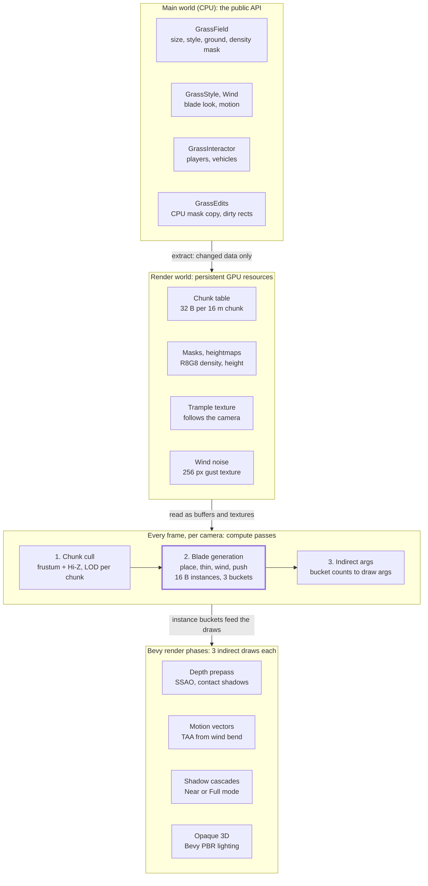

# bevy-grass: Architecture Plan

October 13, 2026

## Summary and goals

bevy-grass is a Bevy plugin that renders dense, tall, wind-animated grass over open-world areas, with the CPU doing almost nothing per frame. Every blade is generated, culled and drawn on the GPU from per-chunk inputs; the user sees one plugin, two components and a style asset.

Priorities, in order, used to settle every trade-off in this plan:

1. **Performance.** Grass must fit a fixed, small slice of the frame budget regardless of world size. No per-blade CPU work, no per-blade entities, no alpha-tested overdraw.
2. **Look.** AAA-grade near-field grass: curved procedural blades, rolling wind gusts, clumping, translucency, correct integration with Bevy's PBR lighting and shadows.
3. **Reusability.** Tiny API, sensible defaults, works with any terrain, drop-in presets.

**Non-goals for v1:** flowers and bushes as separate meshes (a later "decorations" layer), editor tooling beyond a runtime paint API, grass physics beyond displacement, WebGL2 support (see Platform).

## Performance targets and budgets

Grass cost must scale with what the camera sees, never with world size: a 4 × 4 km field costs the same per frame as a 200 × 200 m one. The headline budget is **≤ 1.0 ms GPU and ≤ 0.1 ms CPU per frame** at the High tier on a mid-range GPU at 1080p.

| Tier | Target GPU | GPU budget | CPU budget | Visible blades (approx.) | Grass radius |
| --- | --- | --- | --- | --- | --- |
| Low | Steam Deck, integrated GPUs | 1.0 ms at 800p | 0.1 ms | 80k | 40 m |
| Medium | GTX 1660 / RX 5600 class | 1.0 ms at 1080p | 0.1 ms | 250k | 70 m |
| High | RTX 3060 / RX 6700 class | 1.0 ms at 1080p | 0.1 ms | 600k | 100 m |
| Ultra | RTX 4070 class and up | 1.5 ms at 1440p | 0.1 ms | 1.2M | 150 m |

These are design targets to benchmark against, not measured numbers yet; Milestone 2 validates them. *(M2 is built but has only been measured on a T1200 laptop GPU, below the High tier's hardware; see Status.)*

Budget rules that follow from the targets:

- **CPU:** no per-blade or per-chunk work in the steady state. The CPU only uploads changed chunk descriptors and a few uniforms (camera, wind, interactors).
- **Memory:** per-blade instance data is packed into 16 bytes (position as chunk-local u16 × 3, rotation, height, width, seed, LOD). 1M blades = 16 MB of transient GPU buffer, rebuilt each frame by compute, no CPU copy.
- **Vertex cost:** near blades ≤ 15 vertices, far blades 3; average below 7 across the visible set.
- **Overdraw:** zero alpha testing; blades are opaque geometry so early depth rejection works.
- **Draw calls:** a constant 1–3 indirect draws per view (main pass, optional shadow pass), independent of chunk count.

## Public API

The whole user-facing surface is seven items; a working field takes three lines. Everything else (buffers, pipelines, chunking, LOD) is private and free to change between versions.

```rust
use bevy::prelude::*;
use bevy_grass::prelude::*;

fn main() {
    App::new()
        .add_plugins((DefaultPlugins, GrassPlugin::default())) // quality: GrassQuality::High
        .add_systems(Startup, setup)
        .run();
}

fn setup(mut commands: Commands, assets: Res<AssetServer>, mut styles: ResMut<Assets<GrassStyle>>) {
    // A 512 x 512 m field on a heightmap terrain, using a built-in preset.
    commands.spawn(GrassField {
        size: Vec2::splat(512.0),
        style: styles.add(GrassStyle::MEADOW),
        ground: GrassGround::Heightmap {
            image: assets.load("terrain/height.png"),
            height_scale: 40.0,
        },
        density: Some(assets.load("terrain/grass_mask.png")),
    });

    // Grass bends away from the player.
    commands.spawn((Player, GrassInteractor::default()));
}
```

| Item | Kind | Purpose | State |
| --- | --- | --- | --- |
| `GrassPlugin { quality, max_interactors, instance_capacity }` | Plugin | Registers everything; quality tier sets radius, density and LOD distances; the two limits default from the tier | 🟡 Built with `quality`, `instance_capacity`, `max_interactors` (64 by default) and a `shadows` override |
| `GrassField` | Component | One area of grass: size, style, ground source, optional density mask | ✅ Built |
| `GrassStyle` | Asset | Look of the blades: height, width, curvature, colors, clumping, stiffness; presets as constants | 🟡 Built without clumping; `MEADOW` and `TALL_PRAIRIE` presets so far |
| `GrassGround` | Enum | Where blades sit: `Flat`, `Heightmap { image, height_scale }`, or `Mesh(Handle<Mesh>)` | 🟡 `Flat` and `Heightmap` built; `Mesh` in M5 |
| `Wind` | Resource | Direction, strength, gust scale and speed; affects all fields | ✅ Built, with the four presets |
| `GrassInteractor { radius, strength }` | Component | Anything that flattens grass (player, vehicles, explosions) | ✅ Built in M3 |
| `GrassEdits` | System param | Runtime `paint`, `cut` and `regrow` on a field's density mask | ⬜ M5 |

API rules:

- **Every camera renders grass by default.** A `NoGrass` marker opts a camera out (minimaps, UI cameras); this is the only extra marker. *(Built.)*
- **No entity per blade, chunk or LOD.** One entity per `GrassField`; internal state lives in the render world.
- **All types implement `Default`, `Clone` and `Reflect`**, so they work with BSN, the inspector and serialized scenes.
- **Escape hatch, not a second API:** advanced users can replace the blade WESL via `GrassStyle::shader_override`, documented as unstable. *(Not built yet.)*

## Architecture overview

The CPU's only steady-state job is syncing changed components into the render world; three compute passes then decide which blades exist, and Bevy's own render phases draw them.



Blade generation (highlighted) is where almost all grass work happens, so it is the pass to profile and optimize first.

**Crate layout.** Public types are separate from render code, and every Bevy-internal touch point sits in one file:

```text
bevy_grass/
  src/lib.rs            GrassPlugin, prelude
  src/api/              GrassField, GrassStyle, GrassGround, Wind,
                        GrassInteractor, GrassEdits, presets
  src/extract.rs        main world -> render world sync
  src/render/
    resources.rs        chunk table, masks, instance buffers
    compute.rs          cull, generate, indirect-args passes
    draw.rs             phase items and draw commands
    bevy_glue.rs        every Bevy-internal touch point
  src/shaders/*.wesl    embedded with embedded_asset!
  examples/             one per preset, interaction, editing
  benches/              reference scene flythrough
```

## World representation

Blades are never stored: each blade is recomputed every frame from its chunk and index, so a 4 km field costs a few megabytes of masks, not gigabytes of positions.

**Chunk grid.** Each `GrassField` is divided into 16 × 16 m chunks. A chunk is a 32-byte descriptor: world origin, min and max height (for its bounding box), field index, mask UV rectangle and flags. All descriptors for all fields live in one GPU storage buffer, uploaded once and patched only when a field changes. A 4 × 4 km world is 62,500 chunks, about 2 MB.

**Deterministic placement.** Blade *i* of chunk *c* gets its position from a repeating 64 × 64 blue-noise point tile plus a hash of (c, i). Blue noise avoids the bald patches and clumps of pure random placement. Because the same inputs give the same blade every frame, there is no flicker and no stored state.

**Stable thinning.** Every blade has a hash rank in 0–1. A blade is drawn only if its rank is below the local density, where density = mask value × distance falloff. When density drops (distance, painting, LOD), blades disappear in a fixed order instead of reshuffling, which is what keeps LOD transitions from popping.

**Ground sources.** All three `GrassGround` variants reduce to one heightmap in the compute pass, so there is one code path:

- `Flat`: constant height, no texture.
- `Heightmap`: sampled directly; the ground normal comes from neighbouring texels and tilts blade roots on slopes.
- `Mesh`: baked once at load into a heightmap by rendering the mesh top-down into a depth texture on the GPU, and re-baked if the mesh asset changes.

Overhangs and caves are out of scope; grass assumes a heightfield.

**Density mask.** One R8G8 texture per field: R = density (0 = bare, 1 = full), G = height multiplier (used by cutting). At 0.5 m per texel, a 512 m field is a 1024² mask, 2 MB. Users paint masks in any image editor or through `GrassEdits` at runtime.

**Overlapping fields.** Several fields can overlap (a meadow with a wheat patch on top). Each draws its own blades; the user masks out the overlap. Automatic style blending between fields is a post-1.0 feature.

## GPU pipeline

Each frame, per camera, three small compute dispatches decide which blades exist and three indirect draws render them; the CPU only records the commands. The passes run as systems in Bevy's `Core3d` schedule, which in Bevy 0.20 replaced the old render graph ([Bevy 0.20 release notes](https://bevy.org/news/bevy-0-20/)).

1. **Chunk cull** (compute, one thread per chunk in the camera's grass radius). Tests each chunk's bounding box against the frustum and against a Hi-Z depth pyramid from the previous frame, so chunks behind hills or buildings are skipped. Picks a LOD per chunk from distance. Writes a compact list of visible chunks.
2. **Blade generation** (compute, one workgroup per visible chunk). Each thread evaluates a candidate blade: position, stable-thinning test, per-blade frustum test, ground height, wind bend and interaction push. Survivors are appended with an atomic counter into one of three LOD buckets as 16-byte instances.
3. **Indirect args** (compute, one thread). Copies the three bucket counts into `DrawIndexedIndirect` argument buffers and clamps them to buffer capacity.
4. **Draws.** One `draw_indexed_indirect` per LOD bucket, using a shared index buffer and no vertex buffer: the vertex shader builds the blade from the instance and `vertex_index`.

**Integrating with Bevy's passes.** The grass draws are queued as custom phase items into Bevy's existing phases rather than in a private pass:

- **Depth prepass**, so SSAO, contact shadows and depth of field see the grass.
- **Motion vectors**, computed from this frame's and last frame's wind bend, so TAA does not smear moving blades.
- **Opaque 3D**, lit by Bevy's PBR functions (see Shading).
- **Shadow phase**, for the cascades selected by the shadow mode.
- **Deferred G-buffer**, when the app uses deferred rendering.

**Instance format (16 bytes).**

| Field | Bits | Notes |
| --- | --- | --- |
| Position | 3 × 16 | Chunk-local, quantized to about 0.25 mm horizontally |
| Facing | 8 | Yaw around the ground normal |
| Height, width | 8 + 8 | Scaled by style and mask height multiplier |
| Seed | 8 | Color variation, sway phase |
| Wind bend, current | 2 × 8 | Tip offset direction and amount |
| Wind bend, previous frame | 2 × 8 | For motion vectors |
| LOD and flags | 16 | LOD level, cross-fade dither, chunk index high bits |

**Buffers.** Instance buffers are allocated once at the tier's maximum blade count and reused every frame. If a frame overflows, extra blades in that LOD bucket are dropped, a warning is logged once, and the capacity can be raised via `GrassPlugin`. Each extra camera gets its own instance buffers; split-screen doubles blade memory, not CPU cost.

## Blade geometry and LOD

Every blade is a procedural curved strip built in the vertex shader, with three detail levels and density thinning that keep the average below 7 vertices per visible blade.

**Blade shape.** A blade is a quadratic Bézier curve from root to tip, the approach popularized by Ghost of Tsushima's grass. The control points come from height, lean, curvature and the wind bend in the instance. The vertex shader evaluates the curve at each row of the strip and offsets left and right by a width that tapers to a point at the tip. The curve is re-normalized to keep the blade's length constant, so wind bends blades instead of stretching them.

**Edge-on fix.** A blade seen exactly edge-on becomes a line and the field looks thin. The vertex shader rotates each blade slightly toward the camera as it turns edge-on, which keeps coverage up without making blades look like billboards.

**LOD levels (High tier distances).**

| LOD | Distance | Rows | Vertices | Triangles | Density | Width multiplier |
| --- | --- | --- | --- | --- | --- | --- |
| 0 | 0–20 m | 7 | 15 | 13 | 100% | 1.0× |
| 1 | 20–50 m | 3 | 7 | 5 | 50–100% | 1.0–1.4× |
| 2 | 50–100 m | 1 | 3 | 1 | 15–50% | 1.4–2.5× |

**Constant coverage.** As density thins with distance, blade width grows by the inverse square root of the density drop, so the field reads equally dense at all distances. Far blades are also widened to at least about 1 pixel on screen, which removes most shimmer.

**No visible LOD rings.** LOD changes happen across a 4 m band, not at a hard line. Inside the band each blade picks its level by its own dither value, so the boundary dissolves into noise instead of a ring that follows the camera.

**Far field.** Beyond the grass radius there is no grass geometry. The crate ships a WESL function, `grass_far_color(world_pos)`, that terrain materials call to tint the ground toward the grass color with matching wind shading. A ring of impostor cards between 100 and 250 m is a post-1.0 option for flat open worlds.

## Shading and wind

Wind is computed once per blade in the compute pass, not once per vertex, and lighting goes through Bevy's own PBR functions so grass matches everything else in the scene.

**Wind model.** Three layers, summed into a tip offset stored in the instance:

- **Gusts:** a tileable 256² noise texture, generated at startup, scrolled in world space along the wind direction. Sampled at the blade root, it gives the rolling waves that travel across a field.
- **Sway:** a per-blade sine with phase from the seed and frequency from the style's stiffness, so neighbours never move in lockstep.
- **Flutter:** a small high-frequency term on LOD 0 only, applied in the vertex shader to the top rows.

The previous frame's bend is computed with the same function at the previous time and stored beside the current one, which gives exact motion vectors at no extra sampling cost.

**Lighting.** The fragment shader fills Bevy's `PbrInput` and calls its standard lighting function. Grass therefore receives all light types, clustered lights, cascaded shadows, environment maps, fog and atmosphere without the crate reimplementing any of it. Back faces flip their normal so blades are lit from both sides.

**What makes it look lush** (each item is a few shader instructions):

- **Rounded normals:** normals are tilted up to about 30° across the blade's width, so a flat strip shades like a curved leaf.
- **Root-to-tip gradient:** dark, desaturated roots to brighter tips, plus fake ambient occlusion that darkens roots more where density is high.
- **Clump variation:** hue and brightness vary per clump of about 1 m, not per blade, which reads as natural patches.
- **Translucency:** a thin-surface transmission term brightens blades that are between the camera and the sun.
- **Specular:** rough specular on the upper half of the blade, so wind waves show up as moving sheen.
- **Ground tint:** optional blending of the root color toward the terrain color, so the field sits in the ground instead of on it.

**Shadows.** Grass always receives shadows. Casting is the expensive part, so it is a setting:

| Mode | What casts | Default on |
| --- | --- | --- |
| Off | Nothing | Low |
| Near | LOD 0 blades into the first cascade only | Medium, High |
| Full | LOD 0 and 1 into the first two cascades | Ultra |

Bevy 0.20's contact shadows add short-range, blade-level shadowing in screen space at a cost that scales with pixels, not blades ([Bevy 0.20 release notes](https://bevy.org/news/bevy-0-20/)). The examples enable them and the docs recommend them with Near mode.

**Anti-aliasing.** Thin geometry shimmers. The crate supplies correct motion vectors and enforces the 1-pixel minimum width; the docs recommend TAA (or DLSS where available) for the reference look.

## Interaction and editing

Interaction costs about the same with 1 or 512 interactors, because interactors are drawn into a small texture once and blades sample that texture once each.

**Trample texture.** A 128² RG texture covering 64 × 64 m follows the camera. Each frame a tiny compute pass:

1. Scrolls the texture by the camera's movement, so the trail stays in world space.
2. Decays existing values, so flattened grass springs back over about 1.5 s (tunable).
3. Stamps each `GrassInteractor` as a radial push (direction in RG, strength from the component).

Blade generation samples it at the blade root and adds the push to the wind bend. `GrassPlugin::max_interactors` caps how many are stamped per frame (64 by default; DEMO ARPG GAME uses 512 for its horde). Beyond the cap, the ones nearest the camera are used.

**Runtime edits.** `GrassEdits` changes the density mask:

- `paint(field, center, radius, density)`: grow or remove grass.
- `cut(field, center, radius, height)`: lowers the height multiplier, so mowed grass stays short instead of disappearing.
- `regrow(field, rate)`: optional per-second recovery toward the original mask.

Edits modify a CPU-side copy of the mask and upload only the changed rectangle the same frame. No GPU readback is ever needed.

**Gameplay queries.** Because the mask lives on the CPU too, `GrassEdits::sample(world_pos)` returns density and height at any point in O(1). Games can use it for stealth ("is the player hidden in tall grass?"), footstep sounds or spawn rules without touching the GPU.

## Default presets

The crate ships six grass styles and four wind presets, each tuned against the reference scene so a game looks good before anyone touches a parameter. Quality tiers are in Performance targets.

| Style | Blade height | Look | Typical use |
| --- | --- | --- | --- |
| `GrassStyle::MEADOW` | 0.3–0.6 m | Fresh green, soft, mixed heights, strong clumping | Default for temperate open worlds |
| `GrassStyle::TALL_PRAIRIE` | 0.8–1.4 m | Deep green to straw tips, loose and flowing | Hiding-in-grass gameplay, dramatic wind |
| `GrassStyle::WHEAT` | 0.9–1.2 m | Golden, dense, stiff stems, widened seed-head tips | Farmland |
| `GrassStyle::DRY_SAVANNA` | 0.5–1.0 m | Yellow-brown, sparse clumps, high stiffness | Arid and late-summer biomes |
| `GrassStyle::LAWN` | 0.05–0.12 m | Uniform short green, high density | Gardens, towns, sports fields |
| `GrassStyle::STYLIZED` | 0.4–0.8 m | Flat toon bands, wide blades, no specular | Non-photoreal art styles |

| Wind | Strength | Gust scale | Feel |
| --- | --- | --- | --- |
| `Wind::CALM` | 0.1 | 40 m | Barely moving, gentle sway |
| `Wind::BREEZE` | 0.35 | 25 m | Default; visible rolling waves |
| `Wind::GUSTY` | 0.6 | 15 m | Fast, uneven gusts |
| `Wind::STORM` | 1.0 | 8 m | Heavy bending, fast flutter |

**Added 2026-10-14, at the developer's request:** two tall-grass themes for DEMO ARPG GAME, each with a main look and three variants, all sharing one blade shape (0.7–1.5 m, 4 cm wide, 40 per m², about 16 cm apart) so they mix in one scene. `GrassStyle::SUMMER` is `SUMMER_TALL` (green), `SUMMER_LUSH`, `SUMMER_MEADOW`, `SUMMER_SEEDING`; `GrassStyle::AUTUMN` is `AUTUMN_TALL` (brown), `AUTUMN_RUST`, `AUTUMN_STRAW`, `AUTUMN_FADED`. The `styles` example shows all eight. Density and the distance between blades are one setting seen two ways (`density` in blades per m², or `spacing()` / `with_spacing(metres)`, where spacing is `1 / sqrt(density)`). The shadow mode (`GrassShadows`) is now also a resource, so a game can turn grass shadows on and off at runtime.

Presets are `const` values in Rust and also ship as `.ron` files, so users can copy one, edit it and hot-reload it. The example browser shows every style under every wind preset side by side.

## Platform support and Bevy versions

v1 requires compute shaders, storage buffers and indirect draws, which covers every native backend and WebGPU but not WebGL2.

| Platform | Backend | v1 status | Notes |
| --- | --- | --- | --- |
| Windows | Vulkan, DX12 | Supported | Primary benchmark platform |
| Linux, Steam Deck | Vulkan | Supported | Steam Deck is the Low-tier reference |
| macOS | Metal | Supported | No multi-draw indirect needed (one draw per LOD bucket) |
| Web | WebGPU | Supported | Low or Medium tier recommended |
| Web | WebGL2 | Not supported | Compatibility path is a post-1.0 option (below) |
| iOS, Android | Metal, Vulkan | Best effort | Low tier only; not in CI |

**Compatibility path (post-1.0).** For WebGL2 and weak mobile GPUs: generate per-chunk instance buffers on the CPU when chunks enter range, draw them with ordinary instancing and keep the same vertex shader and styles. It is slower and not GPU-culled, but keeps the API identical.

**Bevy version strategy.**

- Target Bevy 0.20 (released June 19, 2026) for the first release, and check whether 0.21 has shipped before tagging 1.0 ([Bevy 0.20 release notes](https://bevy.org/news/bevy-0-20/)).
- Crate versions follow Bevy minors: bevy-grass 0.20.x supports Bevy 0.20. The README keeps a compatibility table.
- A `bevy-main` branch tracks Bevy's main branch, so each migration starts weeks before a Bevy release, not after it.
- All touch points with Bevy render internals (phase items, the `Core3d` schedule, PBR shader imports, prepass and shadow phases) live in one module, `render/bevy_glue.rs`. Migrations should touch that module and little else.
- Shaders are WESL. Bevy 0.20 already moved its own shaders to WESL and dropped the naga_oil `#import` dialect for imported shaders, so any grass shader that imports `bevy_pbr` must be WESL (`import bevy_pbr::render::pbr_functions::{...}`).

## Testing, roadmap and risks

Performance is a release gate, not a goal: no milestone ships if the reference scene misses the budget for its tier.

**Testing.**

- **Reference scene:** a 2 × 2 km heightmap terrain with a deterministic camera flythrough. It records GPU time per pass with timestamp queries and CPU time with Bevy diagnostics, and writes a CSV per run for comparison across commits.
- **Visual regression:** golden screenshots of each preset at fixed camera and wind time, compared with an image-diff threshold. Runs in CI on a software Vulkan driver, which checks correctness but not speed.
- **Performance runs:** on real tier hardware, before each release and on any change to shaders or buffer layouts.
- **Unit tests:** placement determinism, stable-thinning order, LOD selection and mask edits, tested through CPU mirrors of the shader functions.

**Roadmap.** Seven milestones, each closed by a gate. DEMO ARPG GAME is the first customer, so it gets grass as soon as the GPU-driven core is proven (M3). The general-purpose features it does not need yet follow in M4 and M5. The Implementation plan below breaks each milestone into steps.

```mermaid
flowchart TB
    M0["M0 Foundations<br/>Crate, CI, four Bevy 0.20 spikes, timing harness"] --> G0{{"Gate: spikes pass<br/>compute to indirect draw, PBR, shadow phase"}}
    G0 --> M1["M1 Prototype<br/>Bézier blade, PBR-lit, wind, one CPU-filled chunk<br/>Perspective and DEMO ARPG GAME-orthographic examples"]
    M1 --> G1{{"Gate: look approved<br/>on both cameras"}}
    G1 --> M2["M2 GPU-driven core<br/>Chunk cull, blade generation, indirect args<br/>LOD, stable thinning, constant coverage, tiers"]
    M2 --> G2{{"Gate: budget met<br/>High tier: 1.0 ms GPU, 0.1 ms CPU"}}
    G2 --> M3["M3 DEMO ARPG GAME v1<br/>Trample texture, core shading, shadow casting<br/>Integration in the DEMO ARPG GAME client"]
    M3 --> G3{{"Gate: in-game budget and readability<br/>p95 delta, 300-monster horde, developer sign-off"}}
    G3 --> M4["M4 Complete look<br/>Depth prepass, motion vectors, deferred<br/>Remaining shading tricks, six presets, golden images"]
    M4 --> G4{{"Gate: visuals approved<br/>golden images, budget still met"}}
    G4 --> M5["M5 Editing and ground<br/>GrassEdits, gameplay queries, mesh ground bake<br/>Hi-Z occlusion culling"]
    M5 --> G5{{"Gate: budget under load<br/>512 interactors, live edits"}}
    G5 --> M6["M6 First release<br/>Docs, examples, benchmarks, crates.io publish"]
    M6 --> G6{{"Gate: API frozen<br/>public items reviewed"}}
    classDef done fill:#d8f0dc,stroke:#2e7d32,color:#14301a
    classDef partial fill:#fdf1c8,stroke:#a77b00,color:#3a2b00
    class M0,M1,G1 done
    class G0,M2 partial
    style G2 stroke-width:3px
    style G3 stroke-width:3px
```



**Progress (October 13, 2026):** green is done, yellow is built but not fully checked, white is not started. M0 and M1 are done and G1 passed; G0 is missing only the DX12 run and one image-diff. M2 is built, and G2 waits for a run on target hardware. Details are under Status, and each milestone table below has a State column.

M2 carries the performance gate on purpose: everything after it is built on a pipeline already proven to fit the budget. M3 carries the second gate: the plugin is only done for v1 when it holds its budget inside the real game, next to a 300-monster horde.

**Risks.**

| Risk | Impact | Mitigation |
| --- | --- | --- |
| Bevy render internals change every release | Migration work every few months | All internals behind `render/bevy_glue.rs`; `bevy-main` branch |
| Hi-Z pyramid not exposed by Bevy | Occlusion culling needs a private depth downsample | Build a small one in-crate; frustum and distance culling already meet the budget |
| Thin-geometry aliasing | Shimmer without TAA | 1-pixel minimum width, motion vectors, docs recommend TAA |
| Integrated GPUs miss Low-tier budget | Smaller audience | Lower Low-tier radius; compatibility path post-1.0 |
| Scope creep into a vegetation system | Delays 1.0 | Flowers, bushes, impostors and style blending are explicitly post-1.0 |

**Open questions.**

- Should split-screen share one instance budget across cameras instead of allocating per camera?
- ~~Is a 16 m chunk right for all tiers, or should Low use 32 m chunks to cut cull work?~~ *Answered in M2 (T2):* 16 m for every tier and view; the chunk cull costs 0.016 ms.
- Does the project need a `.bsn` field definition once Bevy ships its asset loader?

**Sources.** [Bevy 0.20 release notes](https://bevy.org/news/bevy-0-20/) (render graph as systems, contact shadows, GPU-driven rendering improvements, WESL plans).

## Implementation plan

This section turns the architecture into ordered steps. Each step ends in a check that proves it worked, and each milestone ends in a gate from the roadmap. It was written on October 13, 2026, after reading the DEMO ARPG GAME repository (`C:\Projects\demo_arpg_game`) and the Bevy `v0.20.0` source (`C:\Projects\bevy`). DEMO ARPG GAME, the first customer, constrains the plan more than the architecture alone suggests.

### What DEMO ARPG GAME changes

DEMO ARPG GAME's camera sets the hardest constraints, not the plugin. Everything in frame is the same distance away, and one pixel covers 2–3 cm of ground.

| DEMO ARPG GAME fact | Source | Consequence for bevy-grass |
| --- | --- | --- |
| Bevy pinned to `=0.20.0` with a fixed feature list | `Cargo.toml`, ADR-025 | bevy-grass pins `bevy = "=0.20.0"` with `default-features = false` and enables only features already on DEMO ARPG GAME's list. One extra Bevy feature would force DEMO ARPG GAME into a ten-minute rebuild of all of Bevy. |
| Orthographic camera: 30° pitch, fixed 45° yaw, 14.64 m tall frame, so 26.0 × 29.3 m of ground at 16:9 | ADR-043, `client/src/camera.rs` | No distance LOD: every blade is the same size on screen. The grass radius becomes the view frame plus margins. About 760 m² is visible, which is 12–20 chunks of 8 m. |
| 73.8 px per screen metre; the smallest readable feature is 2 px (about 3 cm tall or 3.8 cm across) | Art bible §2 | A real 5 mm blade is sub-pixel and shimmers, and DEMO ARPG GAME has no TAA. DEMO ARPG GAME blades are 4–8 cm wide and fewer: 40–80 per m², or 30k–75k in frame. Vertex count is not the risk at this camera; overdraw and fragment shading are. |
| One directional shadow map, no cascades. The shadow pass is already the largest item in the frame. | ADR-060 | Shadow modes must work with a single map in orthographic views. Grass casting stays off in DEMO ARPG GAME until M3 measures its cost. |
| MSAA (Bevy's default), no depth prepass, no TAA, linear `DistanceFog`, colour grade after tonemapping | `camera.rs`, ADR-072 | DEMO ARPG GAME v1 needs only the `Opaque3d` and `Shadow` phases, so prepass and motion vectors move to M4. The pipeline is specialized on the view's MSAA sample count. The fragment shader ends in Bevy's `main_pass_post_lighting_processing`, so fog applies. The grade is a later full-screen pass and needs nothing from grass. |
| Flat ground in 1 m tiles; `Meadow` and `Dense` are two of seven surfaces | `client/src/terrain.rs`, `ground.rs`, C11 | DEMO ARPG GAME uses `GrassGround::Flat`, with one density mask per grass surface built at startup from `Terrain`. Road, mud, sand, rock and sea get zero density. |
| Up to 300 monsters, each an entity, plus the party | ADR-045, `horde_render.rs` | The fixed cap of 64 interactors is too low. It becomes a `GrassPlugin` setting: 64 by default, 512 for DEMO ARPG GAME, nearest to the camera first. Stamping 512 discs into a 128² texture is still trivial. |
| "The client decides nothing." | DEMO ARPG GAME AGENTS.md, I3 | In DEMO ARPG GAME, `GrassEdits::sample` may drive footstep sounds but never a rule. "Hidden in tall grass" would be a `sim-core` rule driven by `sim-core` data. |
| "Walkable space carries low cover." The player, monsters and telegraphs must stay readable. | Art bible §2 (C9), AR-04, T-15 | Whether tall grass may grow on walkable ground is the developer's call (D1 below). The technical answer is ready: the hero, monsters and ground loot are interactors, so grass lies down wherever something stands. |
| `forbid(unsafe_code)`, denied `clippy::pedantic` warnings, `missing_docs`; adding a dependency needs an ADR | DEMO ARPG GAME AGENTS.md §5 | bevy-grass copies DEMO ARPG GAME's lint table. GPU structs derive Bevy's `ShaderType` (encase) instead of `bytemuck::Pod`, so the crate needs no `unsafe impl`. Adopting the crate in DEMO ARPG GAME starts with an ADR. |
| Performance is judged as p95 frame time on `run-client.ps1 -Horde -NoVsync -Frames 600`; profiling uses Bevy's render diagnostics and Tracy | Client AGENTS.md, ADR-069 | Every grass compute pass and draw records a GPU time span through Bevy's render diagnostics, so `--perf` and Tracy show grass by name. The in-game gate compares p95 with and without grass, same seed. |

### Scope of the first version

v1 covers what DEMO ARPG GAME needs plus what the reference scene needs to prove the budget. Nothing in the architecture is dropped; the rest arrives in M4 and M5.

| Area | v1 (M0–M3) | Later | v1 state |
| --- | --- | --- | --- |
| Ground | `Flat`, `Heightmap` with slope normals | `Mesh` bake (M5) | 🟡 `Flat` and `Heightmap` built; slope normals not yet |
| Culling | Chunk and per-blade frustum culling | Hi-Z occlusion (M5) | ✅ Built |
| Bevy phases | `Opaque3d`, `Shadow`, MSAA | Depth prepass, motion vectors, deferred G-buffer (M4) | ✅ Built |
| Look | Bézier blades, PBR lighting, three-layer wind, rounded normals, root gradient and fake AO, clump colour, translucency | Specular, ground tint, toon path, six presets as `.ron` with hot reload, `grass_far_color` (M4) | ✅ Built: clump colour and translucency in M3 (slope normals, under Ground, are not) |
| Interaction | Trample texture with a configurable interactor cap | `GrassEdits` paint, cut, regrow and sample (M5) | ✅ Built in M3 |

### Decisions

Design questions belong to DEMO ARPG GAME's developer. Following DEMO ARPG GAME's AGENTS.md §9, they go to `docs/foundation/OPEN-QUESTIONS.md` with these recommendations, and agents do not decide them.

| # | Question for the developer | Needed by | Recommendation |
| --- | --- | --- | --- |
| D1 | May grass taller than about 0.5 m grow on walkable ground, given C9's "walkable space carries low cover"? | Gate G1 | **Answered October 13, 2026: yes**, with interactors flattening it around the hero, monsters and loot. Tall grass in some areas is part of the Baltic look; C9 was written for the earlier Nordic version and is to be updated in DEMO ARPG GAME's art bible. |
| D2 | Grass's share of DEMO ARPG GAME's frame budget | M3 | ≤ 1.0 ms GPU at p95, 1080p on the development machine, shadow casting included |
| D3 | Grass colours and heights for zone 1 | M3 | Placeholders taken from the art bible's zone-1 anchors (moss green `#6B8A3A`, rust bracken `#8A4A22`), marked `TODO(art-bible, owner: developer)` |
| D4 | Do monsters trample grass, or only the hero? | M3 | Everyone. The horde leaves visible trails, at no extra cost. |
| D5 | Does grass cast shadows in DEMO ARPG GAME? | Gate G3 | Decide on screenshots, with step 3.3's measured cost beside them |

Technical decisions are made here and can be revised by whoever implements the step.

| # | Decision | Reasoning |
| --- | --- | --- |
| T1 | The crate has its own git repository. DEMO ARPG GAME depends on it by git URL and pinned `rev`, never by path. **Revised 2026-10-14 by the developer:** not hosted yet, so DEMO ARPG GAME depends on it by local path for now; the git URL and `rev` come when it is hosted. | DEMO ARPG GAME's CI and lane checkouts cannot see `C:\Projects`. A `[patch]` to a local path is for local work only and is never committed. |
| T2 | ~~Chunk size is set per tier: 16 m for perspective views, 8 m for orthographic ones.~~ **Revised in M2:** one 16 m size for every view. | The chunk table is shared by all cameras, so it cannot depend on one camera's projection. Per-blade frustum culling rejects what a larger chunk lets through, and chunk culling costs 0.016 ms. |
| T3 | Orthographic views use a fixed LOD per tier. **Revised in M2:** LOD 1 at every tier but Ultra (LOD 0). | Distance does not change blade size on screen in an orthographic view. At DEMO ARPG GAME's camera LOD 1 could not be told from LOD 0 at 1:1 and drew 9% faster. |
| T4 | The cull pass sorts visible chunks near to far along the view direction before blade generation. **Not built: the performance pass measured draw order to be worth under 6.5%.** | Atomic appends would then come out roughly front to back, so early depth rejection would remove some overdraw. |
| T5 | Wind runs on Bevy's virtual `Time`. Tests drive it with `TimeUpdateStrategy::ManualDuration`. | Pausing the game pauses the wind, and golden images get an exact wind time without adding API. |

### Milestone steps

Estimates are rough, for one developer working with agents: about 12 weeks to the first release, and about 7 weeks until DEMO ARPG GAME has grass (end of M3).

### Status (October 13, 2026)

| Milestone | State | Gate |
| --- | --- | --- |
| M0 Foundations | ✅ Done, except the DX12 run and Spike B's image-diff | G0 🟡 partly passed |
| M1 Prototype | ✅ Done | G1 ✅ passed |
| M2 GPU-driven core | 🟡 Built; five steps still have a "Done when" check not run (2.1, 2.2, 2.4, 2.5, 2.6) | G2 ⬜ needs RTX 3060 class hardware |
| M3 DEMO ARPG GAME v1 | 🟡 3.1–3.3, 3.5 and 3.6 done; 3.4 drafted (not mergeable until bevy-grass has a repository); 3.7 measured; 3.8 waits for the developer | G3 ⬜ needs D2–D5 and the readability sign-off |
| M4–M6 | ⬜ Not started | ⬜ |

#### Performance pass after M2

Grass was over budget, so common AAA grass optimizations were each tried and measured before more of M2's checks were run. The rule: keep a change only if it cuts grass cost by at least 10%. The full notes, with per-pass numbers, the method and the levers not yet tried, are in [`docs/performance.md`](docs/performance.md); `tools/bench_ab.py` repeats the measurements.

**Method.** The `bench` example, 1,380 measured frames per run, in two scenes: the perspective flythrough (G2's scene) and DEMO ARPG GAME's camera. DEMO ARPG GAME's camera now uses DEMO ARPG GAME's own blades and light, not the meadow style: 5 cm-wide blades at 36 per m², 0.4–0.9 m tall, one shadow cascade. Each variant ran 4–6 times, interleaved with the baseline. Each result is the median of paired differences, run to run, as a share of the baseline's grass cost: 4.68 ms in perspective and 3.17 ms at DEMO ARPG GAME's camera, both on the T1200. Run-to-run noise is about ±2%.

| # | Idea, and where it comes from | Perspective | DEMO ARPG GAME camera | Verdict |
| --- | --- | --- | --- | --- |
| 1 | Cheaper shadow filtering on grass: 4 shadow-map samples instead of Bevy's default 9 (shadowing tricks) | −9.6% | −9.5% | Rejected. Re-tested after 7: −6.9% and −7.3% |
| 2 | No grass shadow casting; rely on the fake root occlusion (disable cast shadows) | −7.3% | **−13.9%** | DEMO ARPG GAME only. `GrassShadows::Off` already exists; this is D5's call for DEMO ARPG GAME. The plugin defaults are unchanged. |
| 3 | Screen-size culling: drop blades under 6 px tall (GPU-driven culling) | −1.7% | 0% | Rejected. At a 100 m radius the smallest blade is still about 4 px tall, so a 1-pixel cull removes nothing. |
| 4 | Ground impostor: grass geometry ends at 60 m instead of 100 m (LOD) | −9.4% | 0% | Rejected, and it costs the far field. Distant grass is cheap; the cost is near the camera. |
| 5 | Occlusion culling, upper bound: chunks hidden behind the terrain skipped exactly, by ray-marching the heightmap (Hi-Z) | −1.8% | −1.0% | Rejected. Bevy draws grass after the terrain, so hidden blades already fail the depth test. It culled up to a quarter of the far blades and still saved under 2%. A real Hi-Z pyramid would save less. |
| 6 | Early depth rejection: draw grass in its own pass before the ground, so the ground under the blades is not shaded (geometry over alpha, early-Z) | +1.6% | +5.8% | Rejected (slower). Ground shows between the blades and MSAA tests depth per sample, so little ground shading is saved; the extra pass reloads the 4× multisampled targets. A test drawing the LOD buckets far-to-near cost +6.5%, so near-to-far sorting (T4) is worth less than that, and was not built. |
| 7 | **Fewer, wider mid-range blades: half the blades from LOD 1's start on, widened by the coverage rule (LOD cards and clumps, kept opaque)** | **−16.5%** | 0% (no distance LOD) | **Kept.** `mirror::MID_RANGE_DENSITY`. Screenshots show no visible change. Thin blades waste most of their fragment work on the 2×2 pixel quads GPUs shade in. |
| 8 | The same at DEMO ARPG GAME's camera: half the blades, 1.41× wider (DEMO ARPG GAME style) | — | **−41.9%** | Passes the performance rule, but the field is visibly sparser and more ground shows. That is an art decision (D3), so the approved style is unchanged. |

Ideas already in the design, so nothing to test: GPU-driven chunk and blade culling with indirect draws (M2); opaque geometry, never alpha (M1); wind sampled from a scrolling world-space noise texture, once per blade in compute rather than per vertex (cheaper than the per-vertex version described); rounded normals and baked root occlusion (M1); no shadow casting beyond LOD 0 and the first cascade (`Near` mode, M2). Interaction through a top-down texture is the trample texture planned for M3. Screen-space contact shadows need a depth prepass, which DEMO ARPG GAME does not have.

**Result:** grass costs 19.5% less in the perspective flythrough (0.91 ms on the T1200, final paired run against the original baseline), and the same at DEMO ARPG GAME's camera. On target hardware the perspective share would scale to roughly 1.0–1.3 ms, near the G2 budget. At DEMO ARPG GAME's camera, the remaining levers are D5 (shadows off: −14%) and the style's blade count and width (D3).

**Bug found by the measurements:** `ChunkLayout::for_density` rounded the tile count to the nearest integer, so some styles were silently capped. DEMO ARPG GAME's 45 blades per m² drew 36, and `TALL_PRAIRIE`'s 40 drew 36. It now rounds up, and a test checks every density from 0.1 to 200 per m². The `arpg_camera` example and the benchmark now ask for 36 per m², the density the developer actually approved at G1. M1's measurement below was taken at that 36.

**Deviation from this document:** the effective density is no longer the architecture's table alone. It is that table times 0.5 from LOD 1 on: 100% to 18 m, 25% where LOD 2 starts, 7.5% at 90% of the radius.

#### M2: implemented, gate G2 not yet passed

Blades are now placed, culled, given a LOD and blown by the wind on the GPU, every frame, for every camera. The CPU only rebuilds the field and chunk tables when a field, style, mask or heightmap changes. All of M2's steps are built. The gate cannot be judged on this machine: G2's budget is for an RTX 3060 class GPU, and the only GPU here is a T1200 laptop part, roughly a third of that.

| Step | State | Evidence and notes |
| --- | --- | --- |
| 2.1 Resources and extract | Done | Shared field table, chunk table (32 B per chunk), masks and heightmaps in storage buffers (no texture arrays, so any number of fields and mask sizes work on every backend); per-camera instance, counter and indirect buffers. A regression test proves a moving camera does not rebuild the tables: that bug (any moving entity triggered a rebuild) cost 16 ms a frame in the benchmark before it was found. |
| 2.2 Chunk cull | Done | One thread per chunk: frustum, radius and density, with boxes grown by the tallest blade and, when a light casts, by the blade's shadow. 0.016 ms. |
| 2.3 Blade generation | Done | One workgroup per visible chunk; candidates are numbered so a thinned chunk only evaluates the ones it can keep; per-blade frustum test (blade and its shadow), LOD, wind with current and previous bend; survivors counted per workgroup before one global atomic per bucket. **GPU readback test:** a headless frame's 92,487 blades match the CPU mirror's 92,487, 99.996% exactly and the rest within one position quantization step (the GPU fuses multiply-adds). |
| 2.4 Indirect args and overflow | Done | Arguments clamped to bucket capacity; counters read back asynchronously every 120 frames, never stalling, with one warning on overflow. `RUST_LOG=bevy_grass=debug` logs visible chunks and blades per bucket. |
| 2.5 LOD and coverage | Done | 4 m dithered bands; widening by the inverse square root of the density drop. No LOD ring is visible in the benchmark screenshot. Mid-distance grass reads darker than near grass, which needs a look on screen before M4. |
| 2.6 Quality tiers | Done | `GrassQuality` sets capacity, radius (40/70/100/150 m), density scale, orthographic LOD and shadow mode. `GrassShadows` (`Off`, `Near`, `Full`) is a new public enum, overridable on `GrassPlugin`. |
| 2.7 Benchmark | Done | `examples/bench.rs`: 2 × 2 km heightmap, deterministic 940 m flythrough or DEMO ARPG GAME's camera panning (`--ortho`), `--no-grass` baseline, CSV per frame. |

**Measured** on the T1200, 1920 × 1080, 4× MSAA, High tier, 1,379 frames each. Grass's share is the difference from a `--no-grass` run over the same frames.

| | Perspective flythrough | DEMO ARPG GAME's camera |
| --- | --- | --- |
| Frame time p50 (no grass) | 6.83 ms (2.21 ms) | 5.65 ms (2.39 ms) |
| Grass in the main pass | +3.50 ms | +2.63 ms |
| Blade generation | 0.89 ms | 0.53 ms |
| Grass in the shadow pass | +0.42 ms | +0.18 ms |
| Chunk cull | 0.016 ms | 0.016 ms |
| Blades drawn (LOD 0 / 1 / 2) | about 16k / 59k / 72k | about 57k, all LOD 1 |

What the measurements showed, and what was changed because of them:

- **The main pass is limited by pixels, not blades.** Culling cut vertex work 4.2× and left the main pass unchanged. Lighting accounts for about half of it: the same frames with a flat colour cost 1.7 ms instead of 3.7 ms.
- **The depth-only pre-pass (the fallback listed under Implementation risks) was built, measured and removed.** It made the main pass slower (4.3 ms against 3.7 ms): it saves lighting but pays for rasterizing every blade twice.
- **Shadows now follow the architecture's `Near` mode at Medium and High.** Drawing every blade into all four cascades cost 2.4 ms; LOD 0 into the first cascade costs 0.42 ms.
- **The CPU cost** of the grass systems is not separately measured. Bevy reports under 0.02 ms of CPU for each grass render pass, and the main-world systems only compare change flags each frame.

**What G2 still needs:** a run of `cargo run --release --example bench` on an RTX 3060 class GPU, against 1.0 ms of grass GPU time. Since the performance pass above, fewer and wider mid-range blades are built in. Near-to-far order (T4) and a smaller radius were measured and found worth less than 10%. The levers left if it misses: a cheaper lighting path written for grass (lighting is half the main pass), and fewer blades near the camera.

#### M0 and M1

M0 and M1 are implemented. **Gate G1 passed on October 13, 2026:** the developer approved the look after running both examples, and answered D1: tall grass may grow on walkable ground, flattened around the hero, monsters and dropped loot by interactors (M3). Everything below was run on one machine: Windows 11, NVIDIA T1200 laptop GPU, Bevy's default backend, physical 1920 × 1080.

| Step | State | Evidence and notes |
| --- | --- | --- |
| 0.1 Crate and CI | Done | DEMO ARPG GAME's lint set; `cargo fmt`, clippy with `-D warnings`, 13 tests and strict rustdoc pass locally. `.github/workflows/ci.yml` is written but has not run (no remote yet). In a scratch crate with DEMO ARPG GAME's exact Bevy dependency, adding bevy-grass leaves every Bevy crate's resolved features identical, with no duplicate Bevy. |
| 0.2 Spike A | Done | A compute pass in the `RenderGraph` schedule (before `camera_driver`) writes the indirect args; three `draw_indexed_indirect` calls draw the grass. Verified on screenshots, not in RenderDoc. |
| 0.3 Spike B | Mostly done | Grass is lit by `apply_pbr_lighting`, receives shadows and (**corrected in M3**: only since M3 — Bevy fogs only materials that set `FOG_ENABLED`, and grass did not; DEMO ARPG GAME's mist showed it) fog through `main_pass_post_lighting_processing`, and runs under MSAA. The image-diff against a `StandardMaterial` quad is not done yet. |
| 0.4 Spike C | Done | Turning off grass shadow casting brightens the ground between the blades by 13.7 grey levels on average in the meadow screenshot; about 220,000 pixels change by more than 20. |
| 0.5 Timing harness | Partly done | Every example takes `--perf` (Bevy's per-pass CPU and GPU time) and `--frames N` (p50/p95). The CSV benchmark moves to step 2.7. |
| 1.1 Public types | Done, with deviations | See below. |
| 1.2 CPU mirrors | Done | 12 unit tests: determinism, every prefix of the tile evenly spread, thinning only removes blades in rank order, packing round-trips, bent blades keep their length within 1%, LOD vertex and triangle counts. |
| 1.3 Blade shader | Done | Bézier blade with constant length, taper, edge-on rotation, rounded normals, minimum pixel width. All three LOD index ranges exist; M1 fills only LOD 0, so no LOD wireframes were captured. |
| 1.4 CPU fill | Done | Whole fields, not one chunk, chunk by chunk as M2 will. Rebuilt only when a field, style or mask changes. |
| 1.5 Wind | Done | Tileable 256² gust texture generated at startup, per-blade sway, flutter on LOD 0. |
| 1.6 Examples | Done | `meadow` (perspective, density-mask clearing, two styles) and `arpg_camera` (DEMO ARPG GAME's camera). `--fixed-time --screenshot` makes repeatable images. |

**Measured** (`arpg_camera --frames 600 --perf`, 64 × 64 m field of 4–9 cm-wide blades at 45 per m² requested but 36 drawn (see the performance pass), about 147k blades, no culling yet):

| Pass | GPU time |
| --- | --- |
| Main opaque pass (grass, ground, one capsule) | 3.5 ms |
| Shadow pass (single cascade) | about 1.9 ms |
| Indirect-args compute | 0.01 ms |
| Whole frame | p50 5.8 ms, p95 7.0 ms |

This is over the 1.0 ms budget, as expected before M2: every blade of the field is drawn, about five times the ground the camera sees. Fragment shader invocations are 2.5× the pixel count, which confirms the overdraw risk listed under Implementation risks: M2's culling and near-to-far order (T4) are the first things to measure against these numbers.

**Deviations from the steps above**, each decided while implementing:

- `GrassStyle` is referenced by `Handle`, so fields write `styles.add(GrassStyle::MEADOW)`; the API example at the top now says so.
- `GrassInteractor` and `GrassPlugin::max_interactors` are not added until M3, where they first do something. A public component with no effect would be a trap.
- `GrassGround` has only `Flat` and is `#[non_exhaustive]`; `Heightmap` arrives with GPU sampling in M2, `Mesh` in M5.
- The blue-noise tile (1,024 points, progressive best-candidate order, fixed seed) is generated once at startup instead of checked in as a constant. It is deterministic, and the prefix test is what makes thinning keep blades evenly spread.
- The main-pass pipeline is a `SpecializedRenderPipeline` that calls `MeshPipeline::specialize` for Bevy's view layouts and shader definitions. Bevy's `SpecializedMeshPipelines` cache assumes a vertex buffer, and grass has none.
- `base_vertex` carries the LOD (`lod × 64`), so indirect draws never need `first_instance`, an optional GPU feature.
- The grass phase item is removed and re-added every frame, because Bevy's binned phases keep items between frames.
- Shadow casting needs `DEPTH_CLIP_CONTROL`. Without it grass casts no shadow rather than a wrong one.
- Bucket capacities are `[capacity, capacity / 2, capacity / 2]` until M2 sizes them per tier.

**Seen on screenshots, left for later milestones:** blades against the sun are nearly black, because there is no translucency until M3 (built in M3: see step 3.2) (Bevy's `diffuse_transmission` is the candidate). M1 filled the instance buffer with blades the camera could not see; M2's chunk cull fixed that.

**Not yet run:** DX12 versus Vulkan (G0 asks for both), the Spike B image-diff, and CI on GitHub.

#### M0 Foundations (about 1 week)

M0 proves the four Bevy 0.20 integration points the design rests on before any grass is written.

| Step | Work | Done when | State |
| --- | --- | --- | --- |
| 0.1 Crate and CI | `bevy_grass` crate, edition 2024, Bevy `=0.20.0` with the feature subset, DEMO ARPG GAME's lint table, module skeleton from the crate layout. CI runs fmt, clippy with `-D warnings`, tests, docs and example builds on Windows and Linux. | CI is green. In a scratch copy of DEMO ARPG GAME, adding the crate shows one Bevy in `cargo tree -d` and prints no `Compiling bevy_*` lines. | ✅ Done. CI written but not yet run (no remote). |
| 0.2 Spike A: compute to indirect draw | A compute system in the `Core3d` schedule, ordered before the prepass and shadow systems as `bevy_pbr`'s `gpu_preprocess.rs` does, writes a count and the indirect args. A `NonMesh` phase item in `Opaque3d` draws that many triangles with `draw_indexed_indirect` and no vertex buffer. Patterns: `examples/shader_advanced/custom_phase_item.rs` and `compute_mesh.rs`. | A RenderDoc capture shows one dispatch and one indirect draw. Changing the count on the GPU changes the triangles drawn, with no CPU upload. | ✅ Done, in the `RenderGraph` schedule before `camera_driver`. Checked on screenshots, not in RenderDoc. |
| 0.3 Spike B: PBR from a custom pipeline | A WESL fragment shader fills `PbrInput` with `pbr_input_new`, then calls `apply_pbr_lighting` and `main_pass_post_lighting_processing`. It binds the view through `mesh_view_bindings`, and the pipeline is specialized on MSAA, HDR, tonemapping and fog. | A quad drawn this way matches a `StandardMaterial` quad of the same colour within an image-diff threshold, under a shadowed directional light with fog and 4× MSAA. | 🟡 Partly: lighting, shadows, fog and MSAA work; the image-diff against a `StandardMaterial` quad is not run. |
| 0.4 Spike C: shadow phase | The Spike A item is queued into `ViewBinnedRenderPhases<Shadow>` for directional-light views with a depth-only pipeline. | The triangles cast shadows on a lit plane in a single-cascade setup like ADR-060's. | ✅ Done |
| 0.5 Timing harness | Every grass pass records a GPU time span through Bevy's render diagnostics. `examples/bench.rs --frames N` writes p50 and p95 to CSV. | `--perf` logs one line per grass pass. | ✅ Done; the CSV is written by step 2.7's benchmark. |

**Gate G0:** all four spikes work on Vulkan and DX12, and Spike A also runs with DEMO ARPG GAME's exact Bevy feature list. If a spike fails, the fallback is recorded before M1 starts (for Spike B, copying the needed PBR functions into the crate).

**State: 🟡 Partly passed.** All four spikes work on this machine's default backend, and bevy-grass leaves DEMO ARPG GAME's resolved Bevy features unchanged. Not yet done: the DX12 and Vulkan comparison, and Spike B's image-diff.

#### M1 Prototype the look (about 1.5 weeks)

M1 draws one chunk that looks right on both camera types. It uses M0's indirect path fed by a CPU-filled buffer, so M2 replaces only the producer.

| Step | Work | Done when | State |
| --- | --- | --- | --- |
| 1.1 Public types | `GrassPlugin { quality, max_interactors, instance_capacity }`, `GrassField` (requires `Transform`; the origin is the field's centre at ground level), the `GrassStyle` asset, `GrassGround`, `Wind`, `GrassInteractor`, `NoGrass`. All derive `Default`, `Clone` and `Reflect`. | Unit tests cover defaults and validation (size above zero, ordered height range). `cargo doc` reports no missing docs. | ✅ Done; `GrassInteractor` and `max_interactors` moved to M3. |
| 1.2 CPU mirrors | `src/mirror.rs`, pure Rust with no render types: hash, the 64 × 64 blue-noise tile, stable-thinning rank, 16-byte instance packing. The tile comes from a test-only Poisson-disc generator and is checked in as a constant. | Property tests: the same inputs give the same blades; lowering density only removes blades, in rank order; packing round-trips within quantization. | ✅ Done; the tile is generated at startup, not checked in. |
| 1.3 Blade vertex shader | Bézier curve at constant length, taper, row count per LOD from one shared index buffer, edge-on rotation, rounded normals, minimum screen width (`GrassStyle::min_width_px`: 1 by default, 2 for DEMO ARPG GAME). | Wireframe screenshots of the three LODs. A CPU-mirror test shows blade length stays within 1% under maximum bend. | ✅ Done; LOD wireframes not captured. |
| 1.4 CPU-filled chunk | One 16 × 16 m chunk filled with the mirror functions, uploaded once, drawn through Spike A with the args set to the blade count | The chunk renders with no per-frame CPU upload (checked in Tracy). | ✅ Done for whole fields; no Tracy capture. Replaced by M2's GPU generation. |
| 1.5 Wind | A tileable 256² gust texture generated at startup; sway and flutter in the vertex shader for now; the four `Wind` presets | A recorded clip shows rolling waves, and neighbouring blades never move in lockstep. | ✅ Done; approved on screen at G1, no clip recorded. |
| 1.6 Examples | `examples/meadow.rs` with a perspective flying camera. `examples/arpg_camera.rs` reproduces DEMO ARPG GAME's camera: orthographic, 30° pitch, 45° yaw, 14.64 m frame, one directional light with one shadow cascade, linear fog, and a 1.8 m capsule for scale. | Both run, and screenshots are captured at a fixed wind time. | ✅ Done |

**Gate G1:** the developer approves the blade look on both cameras and answers D1. The approved screenshots become the first reference images.

**State: ✅ Passed October 13, 2026.**

#### M2 GPU-driven core (about 2.5 weeks)

M2 builds the full compute pipeline from the architecture and proves it inside the budget on the reference scene.

| Step | Work | Done when | State |
| --- | --- | --- | --- |
| 2.1 Render-world resources and extract | Chunk table (32-byte descriptors in one buffer, patched per changed field), field table, mask and height textures, per-view instance buffers at tier capacity, indirect-args buffers. Extract only changed fields, `GrassStyle` asset events, `Wind`, interactors and cameras. | CPU time stays ≤ 0.1 ms in Tracy with four fields. Editing one field re-uploads only its chunks. | 🟡 Built, not fully checked: no Tracy capture with four fields, and any field change still re-uploads every table, not only that field's chunks. |
| 2.2 Chunk cull pass | Chunk boxes tested against the frustum, inflated by maximum blade height plus lean. Orthographic views add margins: blades rooted up to `h × cot(pitch)` below the bottom edge (1.73 h at 30°) still lean into the frame, and when casting, shadows reach `h / tan(sun elevation)` toward the sun (2.4 h at the 22.5° sun DEMO ARPG GAME's art bible rules). LOD per chunk follows T3, order follows T4. The pass writes the visible list and the dispatch args for pass 2. | A GPU readback test (pattern: `examples/shader/gpu_readback.rs`) matches a CPU reference cull for 100 random cameras. | 🟡 Built, not fully checked: the 100-camera readback test is not written; step 2.3's readback test covers the cull for one camera. |
| 2.3 Blade generation pass | One workgroup per visible chunk: candidates, thinning, per-blade frustum test, ground height and slope normal (`Flat` and `Heightmap`), wind with current and previous bend (moved from the vertex shader), append into three LOD buckets | A GPU readback test shows the instances for a fixed chunk equal the CPU mirror's, ignoring order. | ✅ Done: 99.996% of blades match the CPU mirror exactly, the rest within one quantization step. |
| 2.4 Indirect args and overflow | Clamp counts to capacity and record overflow in a small buffer, read back asynchronously a few frames late, never stalling. Warn once. | With capacity forced to 1,000, one warning is logged and blades are dropped with no crash and no flicker elsewhere. | 🟡 Built, not fully checked: the forced 1,000-blade capacity run has not been done. |
| 2.5 LOD transitions and coverage | 4 m dither band, width growth by the inverse square root of the density drop, minimum pixel width | A flythrough clip shows no LOD ring, and the field reads equally dense at all distances. | 🟡 Built, not fully checked: no ring in the benchmark screenshot; no flythrough clip yet, and mid-distance grass reads darker. |
| 2.6 Quality tiers | `GrassQuality` sets chunk size, density, LOD distances, capacity and shadow mode. Orthographic views use the frame plus margins instead of a radius. | Each tier runs the reference scene with no overflow. | 🟡 Built, not fully checked, with one chunk size for every tier (T2). Only High has been run in the benchmark. |
| 2.7 Reference scene and benchmark | A 2 × 2 km heightmap with a deterministic perspective flythrough, plus an orthographic pan over the same terrain. Each run writes a CSV. | Both scenes report GPU time per pass, p50 and p95. | ✅ Done |

**Gate G2:** High tier stays within 1.0 ms GPU and 0.1 ms CPU in the perspective flythrough on High-tier hardware. The orthographic pan is reported alongside it.

**State: ⬜ Not yet passed.** It needs a benchmark run on an RTX 3060 class GPU. On the T1200 grass costs about 4.8 ms in the flythrough and 3.4 ms at DEMO ARPG GAME's camera.

#### M3 DEMO ARPG GAME v1 (about 2 weeks)

M3 puts grass in the game. Done means it holds its budget next to the horde and the hero, monsters and loot stay readable. Steps 3.4–3.8 happen in the DEMO ARPG GAME repository under its AGENTS.md rules, on a lane branch if lanes are in use.

| Step | Work | Done when | State |
| --- | --- | --- | --- |
| 3.1 Trample texture | Compute pass that scrolls, decays and stamps up to `max_interactors`, nearest to the camera first. Blade generation samples it. | 512 interactors cost under 0.05 ms GPU. Trails stay in world space and recover in about 1.5 s while the camera moves. | ✅ Done. The trample pass costs 0.022 ms with 512 interactors and 0.017 ms with none; sampling it adds about 0.05 ms to generation, with or without a horde (T1200). A GPU test checks that trampled grass lies flat away from the interactor, that the trail stays put while the camera moves, and that it recovers in 1.5 s. Cells are sampled nearest, not bilinear; see `docs/performance.md`. |
| 3.2 Core shading | Rounded normals, root-to-tip gradient with fake AO, clump colour variation from 1 m Voronoi cells, translucency | Screenshots with each term toggled, each term measured at under 0.05 ms | ✅ Done. Clump colour: a precomputed Voronoi table, +0.025–0.037 ms. Translucency: one lighting evaluation, the direct light of the sunward side dimmed and tinted for faces turned away from the sun (new `GrassStyle::translucency`), +0.11–0.14 ms on the T1200, over the 0.05 ms target. Screenshots in `target/shots/`. Not yet shown to the developer. |
| 3.3 Shadow casting | `ShadowMode::Near`: LOD 0 into the single orthographic shadow map, or the first cascade in perspective | Cost measured and attached to D5 | ✅ Done early, in M2 (`GrassShadows::Near`): +0.42 ms in the perspective benchmark, +0.18 ms at DEMO ARPG GAME's camera, on the T1200. Not yet measured inside DEMO ARPG GAME. |
| 3.4 DEMO ARPG GAME ADR | "Grass is drawn by bevy-grass": what it pulls in (`cargo tree`, `cargo deny check`), the pinned git `rev`, the Bevy feature subset, what the client may and may not do with grass (I3) | ADR merged. Any of D1–D5 still open are written to `OPEN-QUESTIONS.md`. | 🟡 Drafted: DEMO ARPG GAME `docs/adr/ADR-076-grass-is-drawn-by-bevy-grass.md`, Status Draft, with `cargo tree`, `cargo deny` (bans, licenses, sources ok; advisories fails without this change too) and the I3 rules. D2–D5 and the art bible's C9 are in `OPEN-QUESTIONS.md` as Q-GRASS-1 to 5. DEMO ARPG GAME depends on bevy-grass **from the local disk**, by the developer's ruling of 2026-10-14 (T1 revised), on the local branch `grass-bevy-grass` (commit `e8bd181`), which must not reach `master` until bevy-grass is hosted. |
| 3.5 `crates/client/src/grass.rs` | Adds `GrassPlugin`. In `Startup` (world setup, which decides nothing), it builds one density mask per grass surface from `Terrain` at 2 texels per tile, blurs it by one texel for soft edges and clears it under scenery props. It spawns one `GrassField` per surface with placeholder DEMO ARPG GAME styles marked `TODO(art-bible, owner: developer)`. A `--no-grass` flag turns it off, as `--no-grade` does for the grade. | Unit tests: density is zero on every unwalkable and road tile, and each mask matches the terrain's dimensions. | ✅ Done, in `PostStartup` (after the scenery is planned). One field per grass surface over the map and the ground's 40-tile margin, or over the walkable tiles of a generated layout; masks thin inward at edges and clear under solid scenery. Four unit tests; `nextest` 231/231; clippy clean. |
| 3.6 Interactors | `GrassInteractor` on the hero, on each monster when `horde_render::spawn_missing` spawns it, and on ground loot in `ground_loot.rs` | In the demo, grass lies down around every actor and item. | ✅ Done with observers on `ActorMarker` and `ItemModel`, so `horde_render.rs` and `ground_loot.rs` gain no grass code. Seen on screen: the grass lies flat inside the horde. |
| 3.7 Measurement | `run-client.ps1 -Horde -NoVsync -Frames 600`, three runs with grass and three with `--no-grass`, same seed, p50 and p95, plus a Tracy capture of the grass passes | The p95 difference is within D2's budget, and the numbers are recorded in the ADR. | 🟡 Measured, three interleaved runs each: on the dressed beach, p95 +0.65 ms and p50 +0.77 ms; on the generated layout, p50 +1.05 ms (p95 noisy, +1.65 ms in the one clean round). Dev profile with optimised dependencies, T1200. No Tracy capture yet. Inside D2's recommended 1.0 ms on the beach, but D2 is unanswered. |
| 3.8 Readability | T-15-style screenshots of the meadow with 300 monsters, telegraphs and dropped loot | The developer signs off that the hero, monsters, telegraphs and loot read through the grass. | ⬜ Screenshots taken (DEMO ARPG GAME `target/grass-shots/`, beach with and without grass, generated layout); the developer's sign-off is pending. Not yet captured with `--play` (loot, telegraphs). |

**Gate G3:** steps 3.7 and 3.8 pass, and the developer has answered D2–D5.

**State: ⬜ Not started.**

#### M4 Complete look and Bevy passes (about 2 weeks)

M4 adds the rest of the architecture's look and its integration with Bevy's other passes, for games that use them.

| Step | Work | Done when | State |
| --- | --- | --- | --- |
| 4.1 Depth prepass and motion vectors | Prepass phase items. The vertex shader computes positions from both the current and previous bend. | SSAO sees grass, and a TAA example shows no smearing on moving blades. | ⬜ Not started |
| 4.2 Deferred G-buffer | Deferred output from the same fragment code | The deferred example matches the forward one within the image-diff threshold. | ⬜ Not started |
| 4.3 Remaining shading | Rough specular on the upper half of the blade, ground tint, the toon path for `STYLIZED` | Each term is toggleable and measured. | ⬜ Not started |
| 4.4 Presets | The six styles as constants and as `.ron` files loaded by an asset loader with hot reload; the example browser | Editing a `.ron` updates a running example. | ⬜ Not started |
| 4.5 Far field | The WESL function `grass_far_color(world_pos)` for terrain materials | The perspective example shows no colour seam at the grass radius. | ⬜ Not started |
| 4.6 Golden images | Every preset at a fixed camera and wind time, rendered headless in CI on Linux with lavapipe, diffed against a threshold | CI fails on a deliberate shader change and passes on a clean one. | ⬜ Not started |

**Gate G4:** golden images approved, and the M2 budget still holds.

**State: ⬜ Not started.**

#### M5 Editing and ground (about 2 weeks)

M5 adds runtime editing and the remaining ground source.

| Step | Work | Done when | State |
| --- | --- | --- | --- |
| 5.1 `GrassEdits` | CPU copies of the masks; `paint`, `cut` and `regrow`; changed rectangles uploaded with `RenderQueue::write_texture` | 100 brush strokes a second upload only the changed rectangles, and CPU time stays ≤ 0.1 ms. | ⬜ Not started |
| 5.2 Gameplay queries | `GrassEdits::sample` in O(1) | Unit tests against known masks | ⬜ Not started |
| 5.3 Mesh ground | The mesh is rendered top-down into a depth texture once and re-baked when the mesh asset changes. | Grass sits on a mesh terrain with no floating or buried blades. | ⬜ Not started |
| 5.4 Hi-Z occlusion | Chunk cull also tests against a previous-frame depth pyramid: Bevy's own if the view has one, otherwise a small in-crate downsample. Perspective views only; DEMO ARPG GAME's top-down view gains little. | Chunks behind a hill are skipped in the flythrough, and pass time drops. | ⬜ Not started |

**Gate G5:** the budget holds with 512 interactors and live edits.

**State: ⬜ Not started.**

#### M6 First release (about 1 week)

| Step | Work | Done when | State |
| --- | --- | --- | --- |
| 6.1 Docs | Rustdoc on every public item, a README with the Bevy compatibility table, and a guide to tuning for top-down cameras using DEMO ARPG GAME's numbers | `cargo doc` is clean and every example is linked from the README. | ⬜ Not started |
| 6.2 API review | Each public item is justified; anything only DEMO ARPG GAME needed is reconsidered before the freeze. | The review is recorded, and the API is frozen for the release. | ⬜ Not started |
| 6.3 Publish | crates.io and Bevy Assets. DEMO ARPG GAME moves from the git `rev` to the published version through its ADR process. | DEMO ARPG GAME builds against the published crate. | ⬜ Not started |

**Gate G6:** API frozen.

**State: ⬜ Not started.**

### Implementation risks

These risks surfaced while planning, in addition to the risks listed in the roadmap section.

| Risk | Impact | Mitigation |
| --- | --- | --- |
| Overdraw at DEMO ARPG GAME's camera: three to six layers of PBR-shaded blades per pixel | Exceeds the budget where vertex count would not | Opaque blades with near-to-far order (T4). Measure in M1 on the orthographic example before M2. Fallback: a depth-only grass pre-pass. **Measured in M1 and M2:** the main pass is limited by pixels; the pre-pass was slower and removed; T4 is not built yet. Still open. |
| `Shadow` phase items and PBR shader imports are Bevy internals that change between releases | Breaks on the 0.21 upgrade | Spikes B and C stay in the repository as tests. All of this code lives in `bevy_glue.rs`. |
| Ordering of grass compute relative to Bevy's GPU preprocessing inside `Core3d` | Grass draws stale or empty buffers | Order explicitly before the prepass and shadow systems; Spike A verifies it. **Resolved in M0:** the grass compute runs in the `RenderGraph` schedule before `camera_driver`, so before every phase. |
| DEMO ARPG GAME enables Bevy's `webgl2` feature | If it lowered limits on native builds, storage buffers in vertex shaders would be unavailable | Bevy should apply it only to wasm32 builds. Spike A runs with DEMO ARPG GAME's exact feature list to confirm. **Partly checked in M0:** adding bevy-grass leaves DEMO ARPG GAME's resolved Bevy features identical; grass has not yet run inside DEMO ARPG GAME. |
| Grass hides loot and telegraphs | Breaks DEMO ARPG GAME's readability rules (AR-04) | Interactors on actors and loot, D1, and the sign-off in step 3.8 |
