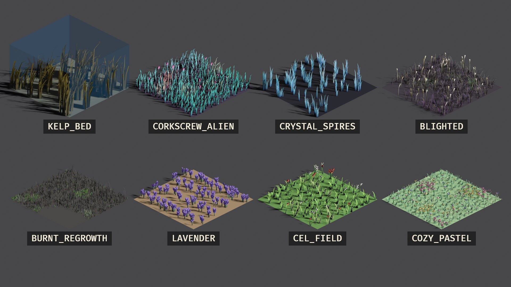
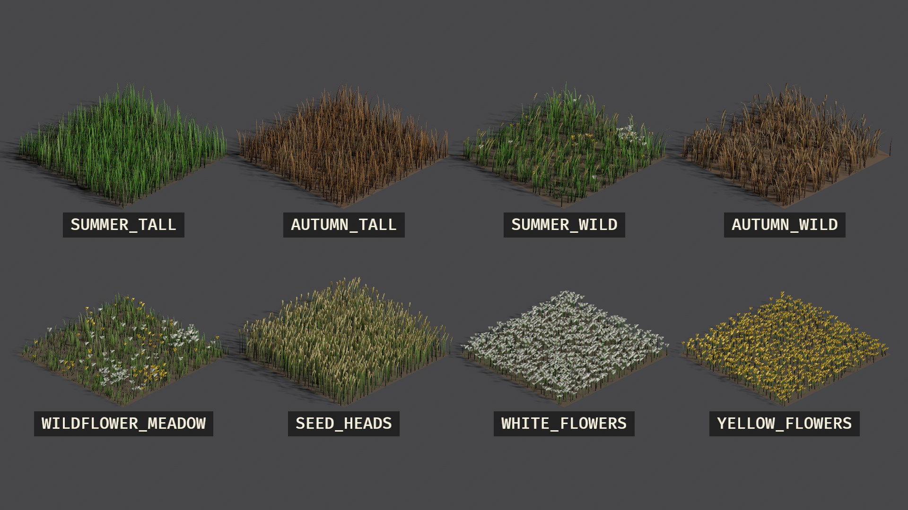

# Presets

bevy_grass ships 36 presets, from lawn to prairie to wildflower meadow,
forest-floor moss and ferns, a Baltic bog, a reed marsh, dunes, pampas,
spinifex, frost, kelp, crystal and cel-shaded fields. Each is a `const` on
`GrassStyle` and a `.grass.ron` file in
[`assets/grass_styles`](../assets/grass_styles); [Styles](styles.md) shows
how to change one or load one from a file.
`GrassStyle::presets()` lists them all with their names, for a menu or an
inspector, and `GrassStyle::preset(name)` finds one by its constant's name.

The pictures show every preset, two rows per picture, each on a square of
about 6 m of its own ground (sand, snow, peat, a pond, the seabed) under a
top-down ARPG camera. Run `cargo run --release --example showcase` for page 1;
`--page 2` to `--page 5` draw the rest (`--fixed-time --screenshot PATH` saves
one). To fly around the biome, fantasy and toon presets up close, run
`cargo run --release --example gallery`.

|  |  |  |
| --- | --- | --- |

## The groups

| Group | Presets |
| --- | --- |
| `GrassStyle::GENERAL` | `MEADOW` (the default), `TALL_PRAIRIE`, `WHEAT`, `DRY_SAVANNA`, `LAWN`, `STYLIZED` |
| `GrassStyle::SEASONS` | `SUMMER_TALL`, `AUTUMN_TALL`: the same tall field, 0.7–1.3 m, green and brown, to mix or blend between. For a lusher or paler variant, tint a field with `GrassFieldOverrides` |
| `GrassStyle::WILD` | `SUMMER_WILD`, `AUTUMN_WILD`, `WILDFLOWER_MEADOW`: every kind of variation |
| `GrassStyle::FOREST` | `FOREST_MOSS`, `FOREST_FERNS`, `FOREST_FLOOR`, `FOREST_BRACKEN`: short, wide forest-floor plants in clumps, with fallen leaves and ferns mixed in |
| `GrassStyle::PLANTS` | `SEED_HEADS`, `WHITE_FLOWERS`, `YELLOW_FLOWERS`, `CLOVER`, `BROAD_LEAF`: to grow alone, or to mix in as species through the `GrassBlade` of the same name (`GrassBlade::CLOVER`) |
| `GrassStyle::BIOMES` | `COTTON_BOG` (red sphagnum, sedge tussocks, cotton grass, pools), `REED_MARSH` (2 m reeds and cattails), `DUNE_MARRAM` (blue-grey clumps on sand), `RYE_AND_CORNFLOWERS` (rye with cornflowers and poppies), `PAMPAS` (arching fountains under cream plumes), `SPINIFEX` (stiff splayed hummocks), `ELEPHANT_GRASS` (2.4–3.6 m, to hide in), `FROSTED_MEADOW` (stiff, glinting, out of snow), `BURNT_REGROWTH` (charcoal stubble and new shoots), `LAVENDER` (bushes; plant them in rows with a striped density mask) |
| `GrassStyle::FANTASY` | `CRYSTAL_SPIRES` (rigid, faceted, glassy), `CORKSCREW_ALIEN` (ribbons twisted two turns, toon), `KELP_BED` (soft ribbons for under water; pair with a slow, lively wind), `BLIGHTED` (corrupted violet grass with bone-white heads) |
| `GrassStyle::TOON` | `CEL_FIELD` (chunky two-band tufts and flowers), `COZY_PASTEL` (soft pastel grass and flowers, four bands) |

`GrassBlade::COTTON_GRASS`, `CATTAIL`, `CORNFLOWER` and `POPPY` are the
plants the biomes mix in, ready to add to any style as species.

## Sizes

How tall each preset grows, how dense it is, and what else grows in it.
Heights are a blade's shortest and tallest, before a field's
`GrassFieldOverrides::height_scale` and the mask's green channel; the tallest
plant includes the flowers and seed heads mixed in. To keep grass below a
unit or a character, pick by the tallest plant, then shorten the field with
`height_scale` if you need to ([Styles](styles.md#how-tall-the-grass-grows)).

<!-- preset numbers: written by `BLESS_STYLES=1 cargo test`, do not edit -->
| Preset | Blade height (m) | Tallest plant (m) | Blades per m² | Spacing (cm) | Plants mixed in |
| --- | --- | --- | --- | --- | --- |
| `MEADOW` | 0.30–0.60 | 0.60 | 60 | 12.9 | none |
| `TALL_PRAIRIE` | 0.80–1.40 | 1.40 | 40 | 15.8 | none |
| `WHEAT` | 0.90–1.20 | 1.20 | 90 | 10.5 | none |
| `DRY_SAVANNA` | 0.50–1.00 | 1.00 | 25 | 20.0 | none |
| `LAWN` | 0.05–0.12 | 0.12 | 250 | 6.3 | none |
| `STYLIZED` | 0.40–0.80 | 0.80 | 30 | 18.3 | none |
| `SUMMER_TALL` | 0.70–1.30 | 1.30 | 40 | 15.8 | none |
| `AUTUMN_TALL` | 0.70–1.30 | 1.30 | 40 | 15.8 | none |
| `SUMMER_WILD` | 0.70–1.30 | 1.40 | 40 | 15.8 | 4, 21% of blades |
| `AUTUMN_WILD` | 0.70–1.30 | 1.40 | 40 | 15.8 | 2, 18% of blades |
| `WILDFLOWER_MEADOW` | 0.30–0.60 | 0.70 | 60 | 12.9 | 3, 27% of blades |
| `SEED_HEADS` | 0.80–1.40 | 1.40 | 40 | 15.8 | none |
| `WHITE_FLOWERS` | 0.35–0.70 | 0.70 | 30 | 18.3 | none |
| `YELLOW_FLOWERS` | 0.30–0.60 | 0.60 | 30 | 18.3 | none |
| `CLOVER` | 0.08–0.20 | 0.20 | 120 | 9.1 | none |
| `BROAD_LEAF` | 0.20–0.45 | 0.45 | 30 | 18.3 | none |
| `FOREST_MOSS` | 0.02–0.07 | 0.07 | 220 | 6.7 | none |
| `FOREST_FERNS` | 0.40–0.90 | 0.90 | 40 | 15.8 | 2, 21% of blades |
| `FOREST_FLOOR` | 0.02–0.07 | 0.90 | 140 | 8.5 | 4, 39% of blades |
| `FOREST_BRACKEN` | 0.35–0.80 | 0.80 | 34 | 17.1 | 2, 20% of blades |
| `COTTON_BOG` | 0.03–0.08 | 0.55 | 200 | 7.1 | 2, 24% of blades |
| `REED_MARSH` | 1.20–2.00 | 2.40 | 45 | 14.9 | 1, 22% of blades |
| `DUNE_MARRAM` | 0.50–0.95 | 0.95 | 45 | 14.9 | none |
| `RYE_AND_CORNFLOWERS` | 1.10–1.60 | 1.60 | 80 | 11.2 | 2, 10% of blades |
| `PAMPAS` | 1.60–2.60 | 3.00 | 70 | 12.0 | 1, 6% of blades |
| `SPINIFEX` | 0.40–0.70 | 0.70 | 130 | 8.8 | none |
| `ELEPHANT_GRASS` | 2.40–3.60 | 3.60 | 40 | 15.8 | 1, 8% of blades |
| `FROSTED_MEADOW` | 0.12–0.32 | 0.70 | 130 | 8.8 | 1, 6% of blades |
| `BURNT_REGROWTH` | 0.08–0.30 | 0.90 | 90 | 10.5 | 2, 28% of blades |
| `LAVENDER` | 0.35–0.60 | 0.60 | 160 | 7.9 | none |
| `CRYSTAL_SPIRES` | 0.30–1.00 | 1.70 | 30 | 18.3 | 1, 6% of blades |
| `CORKSCREW_ALIEN` | 0.60–1.30 | 1.30 | 14 | 26.7 | 1, 8% of blades |
| `KELP_BED` | 1.40–3.00 | 3.00 | 14 | 26.7 | 2, 50% of blades |
| `BLIGHTED` | 0.40–1.00 | 1.20 | 45 | 14.9 | 1, 6% of blades |
| `CEL_FIELD` | 0.35–0.75 | 0.90 | 22 | 21.3 | 2, 10% of blades |
| `COZY_PASTEL` | 0.15–0.35 | 0.45 | 60 | 12.9 | 3, 13% of blades |

<!-- end of preset numbers -->

## Adding a preset to the crate

Every preset is declared once, in [`src/presets/`](../src/presets), one file
per group. Adding one is a single entry in the `preset_group!` block for its
group: the constant, the group's `PRESETS` list, the group array and the
embedded asset are all generated from it, and `BLESS_STYLES=1 cargo test`
writes its `.grass.ron` file in `assets/grass_styles`. There is no second list
to update.
